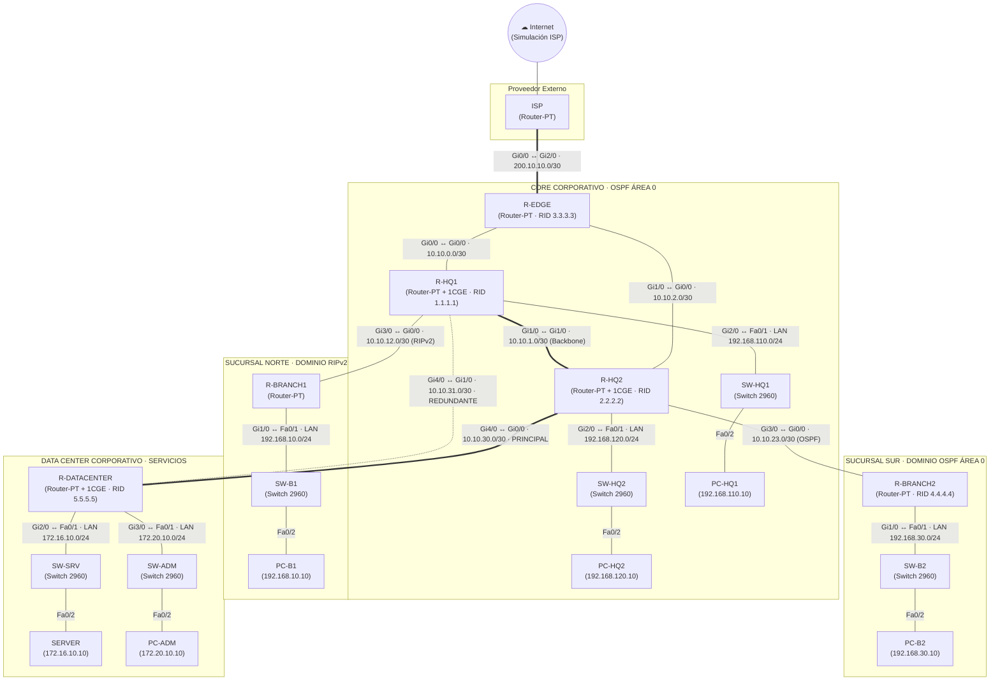

# Proyecto Integrador

### Enrutamiento estatico, RIPv2, OSPF e Inteligencia Artificial aplicada

**Universidad de San Carlos de Guatemala**  
Facultad de Ingeniería · Ingeniería en Ciencias y Sistemas

 

**Segundo semestre de 2026**

 

---

## Información académica

| Campo | Información |
|:--|:--|
| **Estudiante** | Hugo Jorge Luis Pérez Arana |
| **Registro académico** | 201504070 |
| **Catedrático** | Ing. Allan Alberto Morataya Gómez |
| **Auxiliar** | Dominic Juan Pablo Ruano Pérez |
| **Sección** | N |

---

## Descripción del proyecto

El presente proyecto integrador consiste en rediseñar la infraestructura de enrutamiento de **TecnoRed Guatemala, S.A.**, una empresa en crecimiento cuya red combina rutas estáticas, una sucursal heredada que opera con RIPv2 y un núcleo corporativo que migra a OSPF de área única (Área 0). La solución se implementa y verifica en **Cisco Packet Tracer** con una topología de siete routers, seis switches 2960, hosts finales y un servidor, e incluye salida a Internet simulada mediante un router ISP.

El proyecto abarca el direccionamiento IPv4 personalizado con $D = 10$ (subredes /24 y /30), la configuración de rutas estáticas, ruta por defecto y rutas estáticas flotantes, la implementación de RIPv2 con `no auto-summary` en la sucursal heredada, la formación de adyacencias OSPF y el análisis de costos, y la integración entre dominios RIPv2 y OSPF. Asimismo, se contempla un enlace redundante entre `R-HQ1` y `R-DATACENTER` para comprobar la reconvergencia ante una falla controlada, y el uso de un asistente de **Inteligencia Artificial** como apoyo al diagnóstico de salidas de Cisco IOS, cuyas recomendaciones se validan técnicamente en la topología.

---

## 1. Inventario de Dispositivos en Cisco Packet Tracer

| Dispositivo | Modelo en Packet Tracer | Nombre / Hostname | Función Principal |
| :--- | :--- | :--- | :--- |
| Router 1 | Router-PT (módulo `PT-ROUTER-NM-1CGE`) | `ISP` | Simulación de salida a Internet pública |
| Router 2 | Router-PT (módulos `PT-ROUTER-NM-1CGE`) | `R-EDGE` | Router de borde corporativo (OSPF + default route) |
| Router 3 | Router-PT (módulos `PT-ROUTER-NM-1CGE`) | `R-HQ1` | Núcleo OSPF (RID 1.1.1.1) y redistribución con RIPv2 |
| Router 4 | Router-PT (módulos `PT-ROUTER-NM-1CGE`) | `R-HQ2` | Núcleo OSPF (RID 2.2.2.2) y backbone |
| Router 5 | Router-PT (módulos `PT-ROUTER-NM-1CGE`) | `R-BRANCH1` | Sucursal heredada legacy (RIPv2) |
| Router 6 | Router-PT (módulos `PT-ROUTER-NM-1CGE`) | `R-BRANCH2` | Sucursal corporativa (OSPF Área 0, RID 4.4.4.4) |
| Router 7 | Router-PT (módulos `PT-ROUTER-NM-1CGE`) | `R-DATACENTER` | Servicios corporativos (OSPF Área 0, RID 5.5.5.5) |
| Switch 1 | Catalyst 2960-24TT | `SW-HQ1` | Acceso LAN Usuarios Casa Matriz 1 |
| Switch 2 | Catalyst 2960-24TT | `SW-HQ2` | Acceso LAN Usuarios Casa Matriz 2 |
| Switch 3 | Catalyst 2960-24TT | `SW-B1` | Acceso LAN Sucursal Heredada |
| Switch 4 | Catalyst 2960-24TT | `SW-B2` | Acceso LAN Sucursal OSPF |
| Switch 5 | Catalyst 2960-24TT | `SW-SRV` | Segmento Servidores Data Center |
| Switch 6 | Catalyst 2960-24TT | `SW-ADM` | Segmento Administración Data Center |
| Servidor | Server-PT | `SERVER` | Servidor corporativo Data Center |
| PCs (5) | PC-PT | `PC-HQ1`, `PC-HQ2`, `PC-B1`, `PC-B2`, `PC-ADM` | Hosts finales para pruebas de conectividad y traceroute |

---

## 2. Tabla Completa de Direccionamiento IPv4 ($D = 10$)

### Enlaces WAN (/30)
| Enlace | Red Base | Máscara | Host 1 (IP / Interfaz) | Host 2 (IP / Interfaz) | Protocolo |
| :--- | :--- | :--- | :--- | :--- | :--- |
| **R-EDGE ↔ ISP** | `200.10.10.0/30` | `255.255.255.252` | `200.10.10.1` (R-EDGE: Gi2/0) | `200.10.10.2` (ISP: Gi0/0) | Estático / Default |
| **R-EDGE ↔ R-HQ1** | `10.10.0.0/30` | `255.255.255.252` | `10.10.0.1` (R-EDGE: Gi0/0) | `10.10.0.2` (R-HQ1: Gi0/0) | OSPF Área 0 |
| **R-EDGE ↔ R-HQ2** | `10.10.2.0/30` | `255.255.255.252` | `10.10.2.1` (R-EDGE: Gi1/0) | `10.10.2.2` (R-HQ2: Gi0/0) | OSPF Área 0 |
| **R-HQ1 ↔ R-HQ2** | `10.10.1.0/30` | `255.255.255.252` | `10.10.1.1` (R-HQ1: Gi1/0) | `10.10.1.2` (R-HQ2: Gi1/0) | OSPF Área 0 (Backbone) |
| **R-HQ1 ↔ R-BRANCH1** | `10.10.12.0/30` | `255.255.255.252` | `10.10.12.1` (R-HQ1: Gi3/0) | `10.10.12.2` (R-BRANCH1: Gi0/0) | RIPv2 |
| **R-HQ2 ↔ R-BRANCH2** | `10.10.23.0/30` | `255.255.255.252` | `10.10.23.1` (R-HQ2: Gi3/0) | `10.10.23.2` (R-BRANCH2: Gi0/0) | OSPF Área 0 |
| **R-HQ2 ↔ R-DATACENTER** | `10.10.30.0/30` | `255.255.255.252` | `10.10.30.1` (R-HQ2: Gi4/0) | `10.10.30.2` (R-DATACENTER: Gi0/0) | OSPF Área 0 (Principal) |
| **R-HQ1 ↔ R-DATACENTER** | `10.10.31.0/30` | `255.255.255.252` | `10.10.31.1` (R-HQ1: Gi4/0) | `10.10.31.2` (R-DATACENTER: Gi1/0) | OSPF Área 0 (Respaldo) |

### Redes LAN (/24)
| Segmento LAN | Red Base | Gateway (Router / Interfaz) | Rango Hosts / Dispositivos |
| :--- | :--- | :--- | :--- |
| **LAN HQ1** | `192.168.110.0/24` | `192.168.110.1` (R-HQ1: Gi2/0) | `192.168.110.10` (`PC-HQ1`) |
| **LAN HQ2** | `192.168.120.0/24` | `192.168.120.1` (R-HQ2: Gi2/0) | `192.168.120.10` (`PC-HQ2`) |
| **LAN BRANCH1** | `192.168.10.0/24` | `192.168.10.1` (R-BRANCH1: Gi1/0) | `192.168.10.10` (`PC-B1`) |
| **LAN BRANCH2** | `192.168.30.0/24` | `192.168.30.1` (R-BRANCH2: Gi1/0) | `192.168.30.10` (`PC-B2`) |
| **SERVIDORES** | `172.16.10.0/24` | `172.16.10.1` (R-DATACENTER: Gi2/0) | `172.16.10.10` (`SERVER`) |
| **ADMIN** | `172.20.10.0/24` | `172.20.10.1` (R-DATACENTER: Gi3/0) | `172.20.10.10` (`PC-ADM`) |

---

## 3. Topología y Conexiones Físicas

### Diagrama de la topología

### Tabla de conexiones (dispositivos, puertos y cables)

| Origen | Puerto | Destino | Puerto | Cable |
|:--|:--|:--|:--|:--|
| Router-PT `ISP` | `Gi0/0` | Router-PT `R-EDGE` | `Gi2/0` | Copper Cross-Over |
| Router-PT `R-EDGE` | `Gi0/0` | Router-PT `R-HQ1` | `Gi0/0` | Copper Cross-Over |
| Router-PT `R-EDGE` | `Gi1/0` | Router-PT `R-HQ2` | `Gi0/0` | Copper Cross-Over |
| Router-PT `R-HQ1` | `Gi1/0` | Router-PT `R-HQ2` | `Gi1/0` | Copper Cross-Over |
| Router-PT `R-HQ1` | `Gi3/0` | Router-PT `R-BRANCH1` | `Gi0/0` | Copper Cross-Over |
| Router-PT `R-HQ2` | `Gi3/0` | Router-PT `R-BRANCH2` | `Gi0/0` | Copper Cross-Over |
| Router-PT `R-HQ2` | `Gi4/0` | Router-PT `R-DATACENTER` | `Gi0/0` | Copper Cross-Over |
| Router-PT `R-HQ1` | `Gi4/0` | Router-PT `R-DATACENTER` | `Gi1/0` | Copper Cross-Over |
| Router-PT `R-HQ1` | `Gi2/0` | 2960 `SW-HQ1` | `Fa0/1` | Copper Straight-Through |
| Router-PT `R-HQ2` | `Gi2/0` | 2960 `SW-HQ2` | `Fa0/1` | Copper Straight-Through |
| Router-PT `R-BRANCH1` | `Gi1/0` | 2960 `SW-B1` | `Fa0/1` | Copper Straight-Through |
| Router-PT `R-BRANCH2` | `Gi1/0` | 2960 `SW-B2` | `Fa0/1` | Copper Straight-Through |
| Router-PT `R-DATACENTER` | `Gi2/0` | 2960 `SW-SRV` | `Fa0/1` | Copper Straight-Through |
| Router-PT `R-DATACENTER` | `Gi3/0` | 2960 `SW-ADM` | `Fa0/1` | Copper Straight-Through |
| 2960 `SW-HQ1` | `Fa0/2` | PC-PT `PC-HQ1` | `Fa0` | Copper Straight-Through |
| 2960 `SW-HQ2` | `Fa0/2` | PC-PT `PC-HQ2` | `Fa0` | Copper Straight-Through |
| 2960 `SW-B1` | `Fa0/2` | PC-PT `PC-B1` | `Fa0` | Copper Straight-Through |
| 2960 `SW-B2` | `Fa0/2` | PC-PT `PC-B2` | `Fa0` | Copper Straight-Through |
| 2960 `SW-SRV` | `Fa0/2` | Server-PT `SERVER` | `Fa0` | Copper Straight-Through |
| 2960 `SW-ADM` | `Fa0/2` | PC-PT `PC-ADM` | `Fa0` | Copper Straight-Through |

> Los enlaces entre equipos de capa 3 usan cable **cruzado** y los enlaces router–switch y switch–host usan cable **directo**.