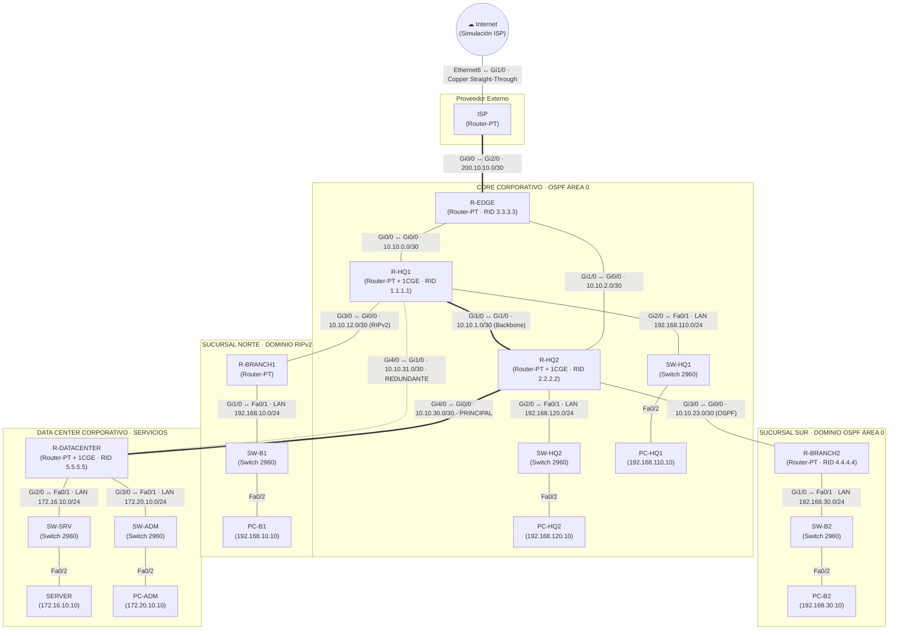

<div align="center">


# Proyecto Integrador

### Enrutamiento estatico, RIPv2, OSPF e Inteligencia Artificial aplicada

**Universidad de San Carlos de Guatemala**  
Facultad de Ingeniería · Ingeniería en Ciencias y Sistemas

<br />


**Segundo semestre de 2026**

<br />


</div>

---

## Información académica

| Campo | Información |
|:--|:--|
| **Estudiante** | Hugo Jorge Luis Pérez Arana |
| **Registro académico** | 201504070 |
| **Catedrático** | Ing. Allan Alberto Morataya Gómez |
| **Auxiliar** | Dominic Juan Pablo Ruano Pérez |
| **Sección** | N |

---

## Descripción del proyecto

El presente proyecto integrador consiste en rediseñar la infraestructura de enrutamiento de **TecnoRed Guatemala, S.A.**, una empresa en crecimiento cuya red combina rutas estáticas, una sucursal heredada que opera con RIPv2 y un núcleo corporativo que migra a OSPF de área única (Área 0). La solución se implementa y verifica en **Cisco Packet Tracer** con una topología de siete routers, seis switches 2960, hosts finales y un servidor, e incluye salida a Internet simulada mediante un router ISP.

El proyecto abarca el direccionamiento IPv4 personalizado con $D = 10$ (subredes /24 y /30), la configuración de rutas estáticas, ruta por defecto y rutas estáticas flotantes, la implementación de RIPv2 con `no auto-summary` en la sucursal heredada, la formación de adyacencias OSPF y el análisis de costos, y la integración entre dominios RIPv2 y OSPF. Asimismo, se contempla un enlace redundante entre `R-HQ1` y `R-DATACENTER` para comprobar la reconvergencia ante una falla controlada, y el uso de un asistente de **Inteligencia Artificial** como apoyo al diagnóstico de salidas de Cisco IOS, cuyas recomendaciones se validan técnicamente en la topología.

---

## 1. Inventario de Dispositivos en Cisco Packet Tracer

| Dispositivo | Modelo en Packet Tracer | Nombre / Hostname | Función Principal |
| :--- | :--- | :--- | :--- |
| Router 1 | Router-PT (módulo `PT-ROUTER-NM-1CGE`) | `ISP` | Simulación de salida a Internet pública |
| Router 2 | Router-PT (módulos `PT-ROUTER-NM-1CGE`) | `R-EDGE` | Router de borde corporativo (OSPF + default route) |
| Router 3 | Router-PT (módulos `PT-ROUTER-NM-1CGE`) | `R-HQ1` | Núcleo OSPF (RID 1.1.1.1) y redistribución con RIPv2 |
| Router 4 | Router-PT (módulos `PT-ROUTER-NM-1CGE`) | `R-HQ2` | Núcleo OSPF (RID 2.2.2.2) y backbone |
| Router 5 | Router-PT (módulos `PT-ROUTER-NM-1CGE`) | `R-BRANCH1` | Sucursal heredada legacy (RIPv2) |
| Router 6 | Router-PT (módulos `PT-ROUTER-NM-1CGE`) | `R-BRANCH2` | Sucursal corporativa (OSPF Área 0, RID 4.4.4.4) |
| Router 7 | Router-PT (módulos `PT-ROUTER-NM-1CGE`) | `R-DATACENTER` | Servicios corporativos (OSPF Área 0, RID 5.5.5.5) |
| Switch 1 | Catalyst 2960-24TT | `SW-HQ1` | Acceso LAN Usuarios Casa Matriz 1 |
| Switch 2 | Catalyst 2960-24TT | `SW-HQ2` | Acceso LAN Usuarios Casa Matriz 2 |
| Switch 3 | Catalyst 2960-24TT | `SW-B1` | Acceso LAN Sucursal Heredada |
| Switch 4 | Catalyst 2960-24TT | `SW-B2` | Acceso LAN Sucursal OSPF |
| Switch 5 | Catalyst 2960-24TT | `SW-SRV` | Segmento Servidores Data Center |
| Switch 6 | Catalyst 2960-24TT | `SW-ADM` | Segmento Administración Data Center |
| Servidor | Server-PT | `SERVER` | Servidor corporativo Data Center |
| Nube | Cloud-PT | `Internet` | Simulación de nube externa / salida a Internet pública |
| PCs (5) | PC-PT | `PC-HQ1`, `PC-HQ2`, `PC-B1`, `PC-B2`, `PC-ADM` | Hosts finales para pruebas de conectividad y traceroute |

> **Nota técnica de hardware en Packet Tracer:**  
> Por defecto, los dispositivos `Router-PT` cargan módulos genéricos mixtos (FastEthernet y Serial). Para estandarizar toda la red corporativa en **Gigabit Ethernet de cobre (RJ-45)**, evitar cables de fibra y no depender de transceptores SFP adicionales, se retiraron los módulos predeterminados de cada router y se instalaron tarjetas modulares **`PT-ROUTER-NM-1CGE`** (Single-Port Copper Gigabit Ethernet), garantizando interfaces Gigabit enrutadas puras para todos los enlaces WAN y LAN.

---

## 2. Tabla Completa de Direccionamiento IPv4 ($D = 10$)

### Enlaces WAN (/30)
| Enlace | Red Base | Máscara | Host 1 (IP / Interfaz) | Host 2 (IP / Interfaz) | Protocolo |
| :--- | :--- | :--- | :--- | :--- | :--- |
| **R-EDGE ↔ ISP** | `200.10.10.0/30` | `255.255.255.252` | `200.10.10.1` (R-EDGE: Gi2/0) | `200.10.10.2` (ISP: Gi0/0) | Estático / Default |
| **R-EDGE ↔ R-HQ1** | `10.10.0.0/30` | `255.255.255.252` | `10.10.0.1` (R-EDGE: Gi0/0) | `10.10.0.2` (R-HQ1: Gi0/0) | OSPF Área 0 |
| **R-EDGE ↔ R-HQ2** | `10.10.2.0/30` | `255.255.255.252` | `10.10.2.1` (R-EDGE: Gi1/0) | `10.10.2.2` (R-HQ2: Gi0/0) | OSPF Área 0 |
| **R-HQ1 ↔ R-HQ2** | `10.10.1.0/30` | `255.255.255.252` | `10.10.1.1` (R-HQ1: Gi1/0) | `10.10.1.2` (R-HQ2: Gi1/0) | OSPF Área 0 (Backbone) |
| **R-HQ1 ↔ R-BRANCH1** | `10.10.12.0/30` | `255.255.255.252` | `10.10.12.1` (R-HQ1: Gi3/0) | `10.10.12.2` (R-BRANCH1: Gi0/0) | RIPv2 |
| **R-HQ2 ↔ R-BRANCH2** | `10.10.23.0/30` | `255.255.255.252` | `10.10.23.1` (R-HQ2: Gi3/0) | `10.10.23.2` (R-BRANCH2: Gi0/0) | OSPF Área 0 |
| **R-HQ2 ↔ R-DATACENTER** | `10.10.30.0/30` | `255.255.255.252` | `10.10.30.1` (R-HQ2: Gi4/0) | `10.10.30.2` (R-DATACENTER: Gi0/0) | OSPF Área 0 (Principal) |
| **R-HQ1 ↔ R-DATACENTER** | `10.10.31.0/30` | `255.255.255.252` | `10.10.31.1` (R-HQ1: Gi4/0) | `10.10.31.2` (R-DATACENTER: Gi1/0) | OSPF Área 0 (Respaldo) |

### Redes LAN (/24)
| Segmento LAN | Red Base | Gateway (Router / Interfaz) | Rango Hosts / Dispositivos |
| :--- | :--- | :--- | :--- |
| **LAN HQ1** | `192.168.110.0/24` | `192.168.110.1` (R-HQ1: Gi2/0) | `192.168.110.10` (`PC-HQ1`) |
| **LAN HQ2** | `192.168.120.0/24` | `192.168.120.1` (R-HQ2: Gi2/0) | `192.168.120.10` (`PC-HQ2`) |
| **LAN BRANCH1** | `192.168.10.0/24` | `192.168.10.1` (R-BRANCH1: Gi1/0) | `192.168.10.10` (`PC-B1`) |
| **LAN BRANCH2** | `192.168.30.0/24` | `192.168.30.1` (R-BRANCH2: Gi1/0) | `192.168.30.10` (`PC-B2`) |
| **SERVIDORES** | `172.16.10.0/24` | `172.16.10.1` (R-DATACENTER: Gi2/0) | `172.16.10.10` (`SERVER`) |
| **ADMIN** | `172.20.10.0/24` | `172.20.10.1` (R-DATACENTER: Gi3/0) | `172.20.10.10` (`PC-ADM`) |

---

## 3. Topología y Conexiones Físicas

### Diagrama de la topología



### Tabla de conexiones (dispositivos, puertos y cables)

| Origen | Puerto | Destino | Puerto | Cable |
|:--|:--|:--|:--|:--|
| Cloud-PT `Internet` | `Ethernet6` | Router-PT `ISP` | `Gi1/0` | Copper Straight-Through |
| Router-PT `ISP` | `Gi0/0` | Router-PT `R-EDGE` | `Gi2/0` | Copper Cross-Over |
| Router-PT `R-EDGE` | `Gi0/0` | Router-PT `R-HQ1` | `Gi0/0` | Copper Cross-Over |
| Router-PT `R-EDGE` | `Gi1/0` | Router-PT `R-HQ2` | `Gi0/0` | Copper Cross-Over |
| Router-PT `R-HQ1` | `Gi1/0` | Router-PT `R-HQ2` | `Gi1/0` | Copper Cross-Over |
| Router-PT `R-HQ1` | `Gi3/0` | Router-PT `R-BRANCH1` | `Gi0/0` | Copper Cross-Over |
| Router-PT `R-HQ2` | `Gi3/0` | Router-PT `R-BRANCH2` | `Gi0/0` | Copper Cross-Over |
| Router-PT `R-HQ2` | `Gi4/0` | Router-PT `R-DATACENTER` | `Gi0/0` | Copper Cross-Over |
| Router-PT `R-HQ1` | `Gi4/0` | Router-PT `R-DATACENTER` | `Gi1/0` | Copper Cross-Over |
| Router-PT `R-HQ1` | `Gi2/0` | 2960 `SW-HQ1` | `Fa0/1` | Copper Straight-Through |
| Router-PT `R-HQ2` | `Gi2/0` | 2960 `SW-HQ2` | `Fa0/1` | Copper Straight-Through |
| Router-PT `R-BRANCH1` | `Gi1/0` | 2960 `SW-B1` | `Fa0/1` | Copper Straight-Through |
| Router-PT `R-BRANCH2` | `Gi1/0` | 2960 `SW-B2` | `Fa0/1` | Copper Straight-Through |
| Router-PT `R-DATACENTER` | `Gi2/0` | 2960 `SW-SRV` | `Fa0/1` | Copper Straight-Through |
| Router-PT `R-DATACENTER` | `Gi3/0` | 2960 `SW-ADM` | `Fa0/1` | Copper Straight-Through |
| 2960 `SW-HQ1` | `Fa0/2` | PC-PT `PC-HQ1` | `Fa0` | Copper Straight-Through |
| 2960 `SW-HQ2` | `Fa0/2` | PC-PT `PC-HQ2` | `Fa0` | Copper Straight-Through |
| 2960 `SW-B1` | `Fa0/2` | PC-PT `PC-B1` | `Fa0` | Copper Straight-Through |
| 2960 `SW-B2` | `Fa0/2` | PC-PT `PC-B2` | `Fa0` | Copper Straight-Through |
| 2960 `SW-SRV` | `Fa0/2` | Server-PT `SERVER` | `Fa0` | Copper Straight-Through |
| 2960 `SW-ADM` | `Fa0/2` | PC-PT `PC-ADM` | `Fa0` | Copper Straight-Through |

> Los enlaces entre equipos de capa 3 usan cable **cruzado** y los enlaces router–switch y switch–host usan cable **directo**.

---

## 4. Fase I - Configuración Inicial y Direccionamiento

### 4.1. Asignación de Hostnames y Parámetros Básicos

Se establece la identidad de cada dispositivo en la topología mediante el comando `hostname`, además de inhabilitar la resolución de nombres por DNS (`no ip domain-lookup`) para evitar bloqueos por errores tipográficos en la consola. Cada bloque de configuración concluye con la persistencia en la memoria no volátil (`write memory`).

#### 4.1.1. Routers

##### Router `ISP`
```cisco
enable
configure terminal
hostname ISP
no ip domain-lookup
end
write memory
```

##### Router `R-EDGE`
```cisco
enable
configure terminal
hostname R-EDGE
no ip domain-lookup
end
write memory
```

##### Router `R-HQ1`
```cisco
enable
configure terminal
hostname R-HQ1
no ip domain-lookup
end
write memory
```

##### Router `R-HQ2`
```cisco
enable
configure terminal
hostname R-HQ2
no ip domain-lookup
end
write memory
```

##### Router `R-BRANCH1`
```cisco
enable
configure terminal
hostname R-BRANCH1
no ip domain-lookup
end
write memory
```

##### Router `R-BRANCH2`
```cisco
enable
configure terminal
hostname R-BRANCH2
no ip domain-lookup
end
write memory
```

##### Router `R-DATACENTER`
```cisco
enable
configure terminal
hostname R-DATACENTER
no ip domain-lookup
end
write memory
```

---

#### 4.1.2. Switches de Acceso (Cisco Catalyst 2960)

##### Switch `SW-HQ1`
```cisco
enable
configure terminal
hostname SW-HQ1
no ip domain-lookup
end
write memory
```

##### Switch `SW-HQ2`
```cisco
enable
configure terminal
hostname SW-HQ2
no ip domain-lookup
end
write memory
```

##### Switch `SW-B1`
```cisco
enable
configure terminal
hostname SW-B1
no ip domain-lookup
end
write memory
```

##### Switch `SW-B2`
```cisco
enable
configure terminal
hostname SW-B2
no ip domain-lookup
end
write memory
```

##### Switch `SW-SRV`
```cisco
enable
configure terminal
hostname SW-SRV
no ip domain-lookup
end
write memory
```

##### Switch `SW-ADM`
```cisco
enable
configure terminal
hostname SW-ADM
no ip domain-lookup
end
write memory
```

---

### 4.2. Configuración de Interfaces, Direccionamiento IP y Descripciones en Routers

Se implementa el direccionamiento IPv4 correspondiente a la Fase I sobre cada interfaz física de los routers. Conforme a las buenas prácticas de administración de redes, cada interfaz es rotulada con un comando `description` que detalla el tipo de enlace (WAN o LAN) y el dispositivo de destino. Finalmente, se habilitan las interfaces mediante `no shutdown` y se guarda la configuración en la NVRAM con `write memory`.

#### Router `ISP`
```cisco
enable
configure terminal
!
interface GigabitEthernet0/0
 description WAN - Enlace hacia R-EDGE (Gi2/0)
 ip address 200.10.10.2 255.255.255.252
 no shutdown
!
interface GigabitEthernet1/0
 description WAN - Salida simulada hacia Internet (Cloud-PT)
 ip address 209.165.200.1 255.255.255.248
 no shutdown
!
interface Loopback0
 description Simulacion Servidor DNS Publico
 ip address 8.8.8.8 255.255.255.255
 no shutdown
!
end
write memory
```

#### Router `R-EDGE`
```cisco
enable
configure terminal
!
interface GigabitEthernet0/0
 description WAN - Enlace hacia R-HQ1 (Gi0/0)
 ip address 10.10.0.1 255.255.255.252
 no shutdown
!
interface GigabitEthernet1/0
 description WAN - Enlace hacia R-HQ2 (Gi0/0)
 ip address 10.10.2.1 255.255.255.252
 no shutdown
!
interface GigabitEthernet2/0
 description WAN - Salida Externa hacia ISP (Gi0/0)
 ip address 200.10.10.1 255.255.255.252
 no shutdown
!
end
write memory
```

#### Router `R-HQ1`
```cisco
enable
configure terminal
!
interface GigabitEthernet0/0
 description WAN - Enlace hacia R-EDGE (Gi0/0)
 ip address 10.10.0.2 255.255.255.252
 no shutdown
!
interface GigabitEthernet1/0
 description WAN - Backbone OSPF hacia R-HQ2 (Gi1/0)
 ip address 10.10.1.1 255.255.255.252
 no shutdown
!
interface GigabitEthernet2/0
 description LAN - Segmento HQ1 Casa Matriz
 ip address 192.168.110.1 255.255.255.0
 no shutdown
!
interface GigabitEthernet3/0
 description WAN - Enlace hacia R-BRANCH1 (Gi0/0) [RIPv2]
 ip address 10.10.12.1 255.255.255.252
 no shutdown
!
interface GigabitEthernet4/0
 description WAN - Enlace Redundante hacia R-DATACENTER (Gi1/0)
 ip address 10.10.31.1 255.255.255.252
 no shutdown
!
end
write memory
```

#### Router `R-HQ2`
```cisco
enable
configure terminal
!
interface GigabitEthernet0/0
 description WAN - Enlace hacia R-EDGE (Gi1/0)
 ip address 10.10.2.2 255.255.255.252
 no shutdown
!
interface GigabitEthernet1/0
 description WAN - Backbone OSPF hacia R-HQ1 (Gi1/0)
 ip address 10.10.1.2 255.255.255.252
 no shutdown
!
interface GigabitEthernet2/0
 description LAN - Segmento HQ2 Casa Matriz
 ip address 192.168.120.1 255.255.255.0
 no shutdown
!
interface GigabitEthernet3/0
 description WAN - Enlace hacia R-BRANCH2 (Gi0/0) [OSPF]
 ip address 10.10.23.1 255.255.255.252
 no shutdown
!
interface GigabitEthernet4/0
 description WAN - Enlace Principal hacia R-DATACENTER (Gi0/0)
 ip address 10.10.30.1 255.255.255.252
 no shutdown
!
end
write memory
```

#### Router `R-BRANCH1`
```cisco
enable
configure terminal
!
interface GigabitEthernet0/0
 description WAN - Enlace hacia R-HQ1 (Gi3/0) [RIPv2]
 ip address 10.10.12.2 255.255.255.252
 no shutdown
!
interface GigabitEthernet1/0
 description LAN - Sucursal Heredada Norte
 ip address 192.168.10.1 255.255.255.0
 no shutdown
!
end
write memory
```

#### Router `R-BRANCH2`
```cisco
enable
configure terminal
!
interface GigabitEthernet0/0
 description WAN - Enlace hacia R-HQ2 (Gi3/0) [OSPF]
 ip address 10.10.23.2 255.255.255.252
 no shutdown
!
interface GigabitEthernet1/0
 description LAN - Sucursal Corporativa Sur
 ip address 192.168.30.1 255.255.255.0
 no shutdown
!
end
write memory
```

#### Router `R-DATACENTER`
```cisco
enable
configure terminal
!
interface GigabitEthernet0/0
 description WAN - Enlace Principal desde R-HQ2 (Gi4/0)
 ip address 10.10.30.2 255.255.255.252
 no shutdown
!
interface GigabitEthernet1/0
 description WAN - Enlace Redundante desde R-HQ1 (Gi4/0)
 ip address 10.10.31.2 255.255.255.252
 no shutdown
!
interface GigabitEthernet2/0
 description LAN - Segmento Servidores Data Center
 ip address 172.16.10.1 255.255.255.0
 no shutdown
!
interface GigabitEthernet3/0
 description LAN - Segmento Administracion Red
 ip address 172.20.10.1 255.255.255.0
 no shutdown
!
end
write memory
```

---

### 4.3. Parámetros de Red para Dispositivos Finales (PCs y Servidor)

Se configuran de manera estática las direcciones IP, máscaras de subred y puertas de enlace predeterminadas en cada equipo terminal:

| Dispositivo | Dirección IPv4 | Máscara de Subred | Puerta de Enlace (Default Gateway) | DNS Server |
| :--- | :--- | :--- | :--- | :--- |
| **`PC-HQ1`** | `192.168.110.10` | `255.255.255.0` | `192.168.110.1` | `8.8.8.8` |
| **`PC-HQ2`** | `192.168.120.10` | `255.255.255.0` | `192.168.120.1` | `8.8.8.8` |
| **`PC-B1`** | `192.168.10.10` | `255.255.255.0` | `192.168.10.1` | `8.8.8.8` |
| **`PC-B2`** | `192.168.30.10` | `255.255.255.0` | `192.168.30.1` | `8.8.8.8` |
| **`SERVER`** | `172.16.10.10` | `255.255.255.0` | `172.16.10.1` | `8.8.8.8` |
| **`PC-ADM`** | `172.20.10.10` | `255.255.255.0` | `172.20.10.1` | `8.8.8.8` |

---

### 4.4. Verificación de Capa Física y Enlaces Directos (Fase I)

Para comprobar el estado operativo de las interfaces y validar la conectividad punto a punto antes de configurar protocolos de enrutamiento dinámico, se ejecutan los siguientes comandos de diagnóstico en los routers:

```cisco
show ip interface brief
```
> Permite certificar que todas las interfaces asignadas se encuentren en estado `Status: up` y `Protocol: up`.

Pruebas de conectividad punto a punto (`ping` a vecinos inmediatos):
* Desde `ISP`: `ping 200.10.10.1` (hacia `R-EDGE`).
* Desde `R-EDGE`: `ping 10.10.0.2` (hacia `R-HQ1`) y `ping 10.10.2.2` (hacia `R-HQ2`).
* Desde `R-HQ1`: `ping 10.10.1.2` (hacia `R-HQ2`), `ping 10.10.12.2` (hacia `R-BRANCH1`) y `ping 10.10.31.2` (hacia `R-DATACENTER`).
* Desde `R-HQ2`: `ping 10.10.23.2` (hacia `R-BRANCH2`) y `ping 10.10.30.2` (hacia `R-DATACENTER`).

#### 4.4.1. Evidencia de Validación Satisfactoria de Capa Física y Enlace
Se constató en la totalidad de los enrutadores que las interfaces configuradas alcanzaron el estado operativo bidireccional (`Status: up`, `Protocol: up`). Asimismo, las solicitudes de eco ICMP (`ping`) arrojaron una efectividad inicial del 80% (primer paquete consumido por resolución de dirección ARP) y posteriormente un 100% de éxito en todos los enlaces directos punto a punto, confirmando la estabilidad de la capa física y de enlace previa al enrutamiento.

---

## 5. Fase II - Enrutamiento Estático, Ruta por Defecto y Rutas Flotantes

En esta fase se establecen los mecanismos de enrutamiento estático con el propósito de comprender la preferencia de rutas basada en la **Distancia Administrativa (AD)** y dotar a la infraestructura de resiliencia ante contingencias. Conforme a las especificaciones del proyecto, se implementan una ruta por defecto hacia el proveedor de servicios, rutas estáticas específicas con AD predeterminada ($AD = 1$) y rutas estáticas flotantes con distancia administrativa incrementada ($AD = 130$).

### 5.1. Configuración de Ruta por Defecto hacia Internet

En el enrutador de borde corporativo (`R-EDGE`) se define una ruta por defecto cuádruple cero (`0.0.0.0 0.0.0.0`) que canaliza todo el tráfico destinado a redes externas hacia la interfaz del proveedor (`ISP`). Simultáneamente, en el enrutador `ISP` se declaran las rutas de retorno hacia el espacio de direccionamiento de la empresa para habilitar la simulación de tráfico bidireccional.

#### Router `R-EDGE` (Ruta por Defecto)
```cisco
enable
configure terminal
!
ip route 0.0.0.0 0.0.0.0 200.10.10.2
!
end
write memory
```

#### Router `ISP` (Rutas Estáticas de Retorno Corporativo)
```cisco
enable
configure terminal
!
ip route 10.10.0.0 255.255.0.0 200.10.10.1
ip route 172.16.0.0 255.240.0.0 200.10.10.1
ip route 192.168.0.0 255.255.0.0 200.10.10.1
!
end
write memory
```

---

### 5.2. Configuración de Ruta Específica y Ruta Estática Flotante ($AD = 130$)

Para evaluar la tolerancia a fallos y la selección de rutas en la tabla de enrutamiento, se toma como caso de estudio el tráfico originado en `R-HQ1` con destino al segmento crítico de Servidores (`172.16.10.0/24`) ubicado en el Data Center:

1. **Ruta Principal Específica ($AD = 1$):** Se encamina el tráfico a través del enrutador de núcleo `R-HQ2` (`10.10.1.2`), el cual a su vez dispone de conexión directa hacia `R-DATACENTER`.
2. **Ruta Estática Flotante ($AD = 130$):** Se configura un camino alternativo a través del enlace directo redundante `R-HQ1` $\leftrightarrow$ `R-DATACENTER` (`10.10.31.2`), asignándole explícitamente una distancia administrativa de 130.
3. **Simetría en `R-DATACENTER`:** Se replica la misma lógica de ruta primaria ($AD = 1$ vía `R-HQ2`) y ruta flotante ($AD = 130$ vía `R-HQ1`) para la red de usuarios de Casa Matriz 1 (`192.168.110.0/24`).

#### Router `R-HQ1`
```cisco
enable
configure terminal
!
ip route 172.16.10.0 255.255.255.0 10.10.1.2
ip route 172.16.10.0 255.255.255.0 10.10.31.2 130
!
end
write memory
```

#### Router `R-HQ2` (Enrutamiento de Tránsito al Data Center)
```cisco
enable
configure terminal
!
ip route 172.16.10.0 255.255.255.0 10.10.30.2
ip route 192.168.110.0 255.255.255.0 10.10.1.1
!
end
write memory
```

#### Router `R-DATACENTER`
```cisco
enable
configure terminal
!
ip route 192.168.110.0 255.255.255.0 10.10.30.1
ip route 192.168.110.0 255.255.255.0 10.10.31.1 130
!
end
write memory
```

---

### 5.3. Análisis Técnico Obligatorio: Mecanismo de la Ruta Flotante

#### 1. Fundamento de la Distancia Administrativa (AD)
La Distancia Administrativa es el parámetro utilizado por Cisco IOS para medir la confiabilidad de la fuente de enrutamiento. A menor valor de AD, mayor es la prioridad del protocolo o método para instalar la ruta en la tabla de enrutamiento activa (**RIB** - *Routing Information Base*).
* Ruta estática estándar: $AD = 1$
* Ruta estática flotante configurada: $AD = 130$

Mientras el enlace primario (`Gi1/0` en `R-HQ1`) permanezca activo, la ruta hacia `172.16.10.0/24` vía `10.10.1.2` posee $AD = 1$. Dado que $1 < 130$, el algoritmo de selección instala exclusivamente la ruta con $AD = 1$. La ruta flotante permanece en la configuración (`running-config`), pero oculta de la tabla de enrutamiento principal.

#### 2. Comportamiento y Conmutación ante Falla Controlada
Al simular la caída del enlace principal apagando la interfaz del camino primario:
```cisco
! En R-HQ1:
interface GigabitEthernet1/0
 shutdown
```
El enrutador detecta que la interfaz de salida hacia el next-hop `10.10.1.2` se encuentra inoperativa. En consecuencia:
1. La ruta estática principal con $AD = 1$ es purgada de la tabla de enrutamiento.
2. El enrutador evalúa las fuentes alternativas existentes en memoria y localiza la ruta hacia `172.16.10.0/24` con $AD = 130$.
3. Dado que su siguiente salto (`10.10.31.2`) a través del enlace redundante `Gi4/0` se encuentra activo, la ruta flotante es **promovida e instalada de inmediato en la tabla de enrutamiento** con la designación `S 172.16.10.0/24 [130/0] via 10.10.31.2`.
4. El tráfico de red conmuta al enlace de respaldo sin pérdida prolongada de conectividad.

Al restaurar el enlace (`no shutdown` en `Gi1/0`), la ruta con $AD = 1$ vuelve a estar disponible y desaloja inmediatamente a la ruta flotante por tener menor distancia administrativa.

#### 3. Evidencia Experimental Obtenida en Consola
Durante las pruebas de validación en `R-HQ1`, se registraron las siguientes salidas que confirman el funcionamiento del mecanismo de ruta flotante:

* **Estado inicial (enlace activo, ruta principal $AD = 1$ instalada):**
```text
R-HQ1#show ip route static
     172.16.0.0/24 is subnetted, 1 subnets
S       172.16.10.0 [1/0] via 10.10.1.2
```

* **Conmutación ante falla (interfaz `Gi1/0` en estado `shutdown`, ruta flotante $AD = 130$ promovida a la RIB):**
```text
R-HQ1#show ip route static
     172.16.0.0/24 is subnetted, 1 subnets
S       172.16.10.0 [130/0] via 10.10.31.2
```

---

## 6. Fase III - RIPv2 en Sucursal Norte (Dominio Heredado)

La sucursal `R-BRANCH1` representa una infraestructura heredada (*legacy*) que opera bajo el protocolo de enrutamiento por vector de distancias **RIP versión 2 (RIPv2)**. En esta fase se implementa el protocolo en dicho enrutador y en la interfaz fronteriza correspondiente de `R-HQ1`, asegurando la propagación de prefijos de longitud variable y el control de actualizaciones hacia segmentos de usuario.

### 6.1. Fundamentos Técnicos del Protocolo RIPv2

1. **Métrica y Límite de Saltos (*Hop Count*):**  
   RIP utiliza como única métrica el número de saltos (*hops*) que un paquete debe atravesar hasta la red destino. Cada enrutador intermedio incrementa la métrica en 1.
   * **Diámetro máximo:** 15 saltos.
   * **Inalcanzabilidad:** Una métrica de 16 saltos es interpretada como infinito (*unreachable*), mecanismo esencial para mitigar bucles de enrutamiento mediante la técnica de envenenamiento de ruta (*route poisoning*).
2. **Desactivación de Auto-Resumen (`no auto-summary`):**  
   Por defecto, RIP resume las redes en sus límites con clase (*classful boundaries*). El comando `no auto-summary` permite que RIPv2 opere en modo sin clase (*classless* / CIDR), transmitiendo la máscara de subred completa en las actualizaciones multicast (`224.0.0.9`) y preservando subredes como `/24` o `/30`.
3. **Interfaces Pasivas (`passive-interface`):**  
   Se inhabilitan los envíos periódicos de actualizaciones RIP a través de las interfaces conectadas a redes de usuarios (como `Gi1/0` en `R-BRANCH1`), evitando el consumo innecesario de ancho de banda y reforzando la seguridad al no divulgar información topológica en la LAN.
4. **Punto de Anuncio hacia el Núcleo:**  
   El enrutador `R-HQ1` actúa como enrutador de frontera de sistema autónomo / protocolo. Es `R-HQ1` el dispositivo encargado de recibir las publicaciones de `R-BRANCH1` y posteriormente redistribuirlas hacia el núcleo corporativo OSPF.

---

### 6.2. Configuración de RIPv2

#### Router `R-BRANCH1` (Sucursal Heredada)
```cisco
enable
configure terminal
!
router rip
 version 2
 no auto-summary
 network 10.0.0.0
 network 192.168.10.0
 passive-interface GigabitEthernet1/0
!
end
write memory
```

#### Router `R-HQ1` (Frontera RIPv2 en Interfaz `Gi3/0`)
```cisco
enable
configure terminal
!
router rip
 version 2
 no auto-summary
 network 10.0.0.0
 passive-interface default
 no passive-interface GigabitEthernet3/0
!
end
write memory
```

---

### 6.3. Verificación y Diagnóstico de RIPv2

Una vez aplicadas las configuraciones, se ejecutan los comandos de verificación para constatar la operación del protocolo:

1. **Parámetros y Redes Anunciadas:**
   ```cisco
   show ip protocols
   ```
   > Permite certificar el uso de RIP versión 2, la vigencia de `no auto-summary`, las interfaces pasivas configuradas y los temporizadores de actualización.

2. **Tabla de Enrutamiento en `R-HQ1`:**
   ```cisco
   show ip route rip
   ```
   > Se debe identificar la red remota de la sucursal precedida por el código **`R`**:  
   > `R 192.168.10.0/24 [120/1] via 10.10.12.2, GigabitEthernet3/0`  
   > Donde `120` representa la Distancia Administrativa de RIP y `1` corresponde al costo en saltos (*hop count*).


