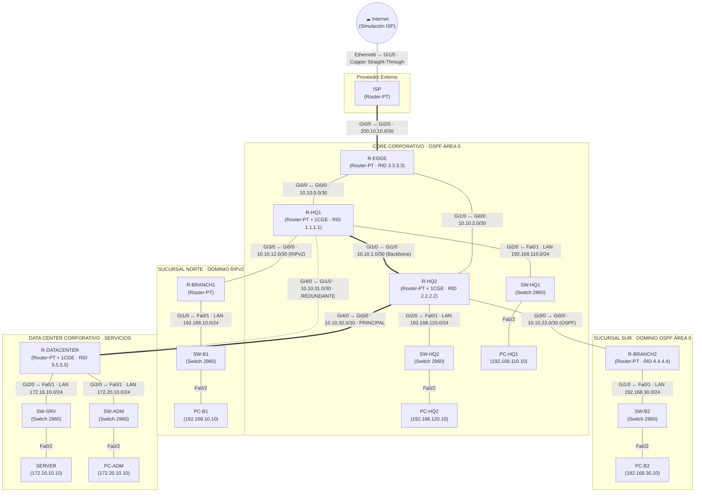
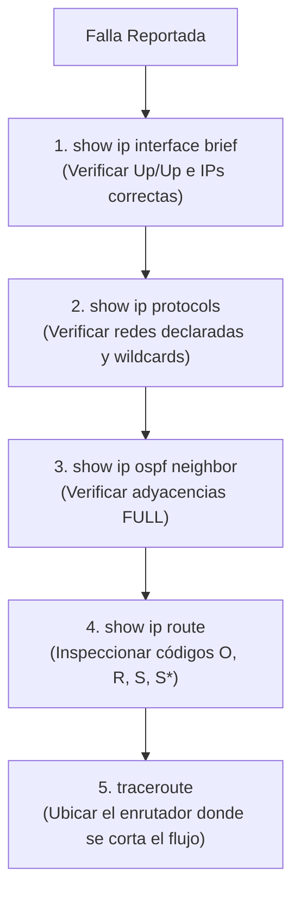

<div align="center">


# Proyecto Integrador

### Enrutamiento estatico, RIPv2, OSPF e Inteligencia Artificial aplicada

**Universidad de San Carlos de Guatemala**  
Facultad de Ingeniería · Ingeniería en Ciencias y Sistemas

<br />


**Segundo semestre de 2026**

<br />


</div>

---

## Información académica

| Campo | Información |
|:--|:--|
| **Estudiante** | Hugo Jorge Luis Pérez Arana |
| **Registro académico** | 201504070 |
| **Catedrático** | Ing. Allan Alberto Morataya Gómez |
| **Auxiliar** | Dominic Juan Pablo Ruano Pérez |
| **Sección** | N |

---

## Descripción del proyecto

El presente proyecto integrador consiste en rediseñar la infraestructura de enrutamiento de **TecnoRed Guatemala, S.A.**, una empresa en crecimiento cuya red combina rutas estáticas, una sucursal heredada que opera con RIPv2 y un núcleo corporativo que migra a OSPF de área única (Área 0). La solución se implementa y verifica en **Cisco Packet Tracer** con una topología de siete routers, seis switches 2960, hosts finales y un servidor, e incluye salida a Internet simulada mediante un router ISP.

El proyecto abarca el direccionamiento IPv4 personalizado con $D = 10$ (subredes /24 y /30), la configuración de rutas estáticas, ruta por defecto y rutas estáticas flotantes, la implementación de RIPv2 con `no auto-summary` en la sucursal heredada, la formación de adyacencias OSPF y el análisis de costos, y la integración entre dominios RIPv2 y OSPF. Asimismo, se contempla un enlace redundante entre `R-HQ1` y `R-DATACENTER` para comprobar la reconvergencia ante una falla controlada, y el uso de un asistente de **Inteligencia Artificial** como apoyo al diagnóstico de salidas de Cisco IOS, cuyas recomendaciones se validan técnicamente en la topología.

---

## 1. Inventario de Dispositivos en Cisco Packet Tracer

| Dispositivo | Modelo en Packet Tracer | Nombre / Hostname | Función Principal |
| :--- | :--- | :--- | :--- |
| Router 1 | Router-PT (módulo `PT-ROUTER-NM-1CGE`) | `ISP` | Simulación de salida a Internet pública |
| Router 2 | Router-PT (módulos `PT-ROUTER-NM-1CGE`) | `R-EDGE` | Router de borde corporativo (OSPF + default route) |
| Router 3 | Router-PT (módulos `PT-ROUTER-NM-1CGE`) | `R-HQ1` | Núcleo OSPF (RID 1.1.1.1) y redistribución con RIPv2 |
| Router 4 | Router-PT (módulos `PT-ROUTER-NM-1CGE`) | `R-HQ2` | Núcleo OSPF (RID 2.2.2.2) y backbone |
| Router 5 | Router-PT (módulos `PT-ROUTER-NM-1CGE`) | `R-BRANCH1` | Sucursal heredada legacy (RIPv2) |
| Router 6 | Router-PT (módulos `PT-ROUTER-NM-1CGE`) | `R-BRANCH2` | Sucursal corporativa (OSPF Área 0, RID 4.4.4.4) |
| Router 7 | Router-PT (módulos `PT-ROUTER-NM-1CGE`) | `R-DATACENTER` | Servicios corporativos (OSPF Área 0, RID 5.5.5.5) |
| Switch 1 | Catalyst 2960-24TT | `SW-HQ1` | Acceso LAN Usuarios Casa Matriz 1 |
| Switch 2 | Catalyst 2960-24TT | `SW-HQ2` | Acceso LAN Usuarios Casa Matriz 2 |
| Switch 3 | Catalyst 2960-24TT | `SW-B1` | Acceso LAN Sucursal Heredada |
| Switch 4 | Catalyst 2960-24TT | `SW-B2` | Acceso LAN Sucursal OSPF |
| Switch 5 | Catalyst 2960-24TT | `SW-SRV` | Segmento Servidores Data Center |
| Switch 6 | Catalyst 2960-24TT | `SW-ADM` | Segmento Administración Data Center |
| Servidor | Server-PT | `SERVER` | Servidor corporativo Data Center |
| Nube | Cloud-PT | `Internet` | Simulación de nube externa / salida a Internet pública |
| PCs (5) | PC-PT | `PC-HQ1`, `PC-HQ2`, `PC-B1`, `PC-B2`, `PC-ADM` | Hosts finales para pruebas de conectividad y traceroute |

> **Nota técnica de hardware en Packet Tracer:**  
> Por defecto, los dispositivos `Router-PT` cargan módulos genéricos mixtos (FastEthernet y Serial). Para estandarizar toda la red corporativa en **Gigabit Ethernet de cobre (RJ-45)**, evitar cables de fibra y no depender de transceptores SFP adicionales, se retiraron los módulos predeterminados de cada router y se instalaron tarjetas modulares **`PT-ROUTER-NM-1CGE`** (Single-Port Copper Gigabit Ethernet), garantizando interfaces Gigabit enrutadas puras para todos los enlaces WAN y LAN.

---

## 2. Tabla Completa de Direccionamiento IPv4 ($D = 10$)

### Enlaces WAN (/30)
| Enlace | Red Base | Máscara | Host 1 (IP / Interfaz) | Host 2 (IP / Interfaz) | Protocolo |
| :--- | :--- | :--- | :--- | :--- | :--- |
| **R-EDGE ↔ ISP** | `200.10.10.0/30` | `255.255.255.252` | `200.10.10.1` (R-EDGE: Gi2/0) | `200.10.10.2` (ISP: Gi0/0) | Estático / Default |
| **R-EDGE ↔ R-HQ1** | `10.10.0.0/30` | `255.255.255.252` | `10.10.0.1` (R-EDGE: Gi0/0) | `10.10.0.2` (R-HQ1: Gi0/0) | OSPF Área 0 |
| **R-EDGE ↔ R-HQ2** | `10.10.2.0/30` | `255.255.255.252` | `10.10.2.1` (R-EDGE: Gi1/0) | `10.10.2.2` (R-HQ2: Gi0/0) | OSPF Área 0 |
| **R-HQ1 ↔ R-HQ2** | `10.10.1.0/30` | `255.255.255.252` | `10.10.1.1` (R-HQ1: Gi1/0) | `10.10.1.2` (R-HQ2: Gi1/0) | OSPF Área 0 (Backbone) |
| **R-HQ1 ↔ R-BRANCH1** | `10.10.12.0/30` | `255.255.255.252` | `10.10.12.1` (R-HQ1: Gi3/0) | `10.10.12.2` (R-BRANCH1: Gi0/0) | RIPv2 |
| **R-HQ2 ↔ R-BRANCH2** | `10.10.23.0/30` | `255.255.255.252` | `10.10.23.1` (R-HQ2: Gi3/0) | `10.10.23.2` (R-BRANCH2: Gi0/0) | OSPF Área 0 |
| **R-HQ2 ↔ R-DATACENTER** | `10.10.30.0/30` | `255.255.255.252` | `10.10.30.1` (R-HQ2: Gi4/0) | `10.10.30.2` (R-DATACENTER: Gi0/0) | OSPF Área 0 (Principal) |
| **R-HQ1 ↔ R-DATACENTER** | `10.10.31.0/30` | `255.255.255.252` | `10.10.31.1` (R-HQ1: Gi4/0) | `10.10.31.2` (R-DATACENTER: Gi1/0) | OSPF Área 0 (Respaldo) |

### Redes LAN (/24)
| Segmento LAN | Red Base | Gateway (Router / Interfaz) | Rango Hosts / Dispositivos |
| :--- | :--- | :--- | :--- |
| **LAN HQ1** | `192.168.110.0/24` | `192.168.110.1` (R-HQ1: Gi2/0) | `192.168.110.10` (`PC-HQ1`) |
| **LAN HQ2** | `192.168.120.0/24` | `192.168.120.1` (R-HQ2: Gi2/0) | `192.168.120.10` (`PC-HQ2`) |
| **LAN BRANCH1** | `192.168.10.0/24` | `192.168.10.1` (R-BRANCH1: Gi1/0) | `192.168.10.10` (`PC-B1`) |
| **LAN BRANCH2** | `192.168.30.0/24` | `192.168.30.1` (R-BRANCH2: Gi1/0) | `192.168.30.10` (`PC-B2`) |
| **SERVIDORES** | `172.16.10.0/24` | `172.16.10.1` (R-DATACENTER: Gi2/0) | `172.16.10.10` (`SERVER`) |
| **ADMIN** | `172.20.10.0/24` | `172.20.10.1` (R-DATACENTER: Gi3/0) | `172.20.10.10` (`PC-ADM`) |

---

## 3. Topología y Conexiones Físicas

### Diagrama de la topología



### Topología en Cisco Packet Tracer

<div align="center">
  
  <p>Topología completa en Cisco Packet Tracer</p>
</div>


### Tabla de conexiones (dispositivos, puertos y cables)

| Origen | Puerto | Destino | Puerto | Cable |
|:--|:--|:--|:--|:--|
| Cloud-PT `Internet` | `Ethernet6` | Router-PT `ISP` | `Gi1/0` | Copper Straight-Through |
| Router-PT `ISP` | `Gi0/0` | Router-PT `R-EDGE` | `Gi2/0` | Copper Cross-Over |
| Router-PT `R-EDGE` | `Gi0/0` | Router-PT `R-HQ1` | `Gi0/0` | Copper Cross-Over |
| Router-PT `R-EDGE` | `Gi1/0` | Router-PT `R-HQ2` | `Gi0/0` | Copper Cross-Over |
| Router-PT `R-HQ1` | `Gi1/0` | Router-PT `R-HQ2` | `Gi1/0` | Copper Cross-Over |
| Router-PT `R-HQ1` | `Gi3/0` | Router-PT `R-BRANCH1` | `Gi0/0` | Copper Cross-Over |
| Router-PT `R-HQ2` | `Gi3/0` | Router-PT `R-BRANCH2` | `Gi0/0` | Copper Cross-Over |
| Router-PT `R-HQ2` | `Gi4/0` | Router-PT `R-DATACENTER` | `Gi0/0` | Copper Cross-Over |
| Router-PT `R-HQ1` | `Gi4/0` | Router-PT `R-DATACENTER` | `Gi1/0` | Copper Cross-Over |
| Router-PT `R-HQ1` | `Gi2/0` | 2960 `SW-HQ1` | `Fa0/1` | Copper Straight-Through |
| Router-PT `R-HQ2` | `Gi2/0` | 2960 `SW-HQ2` | `Fa0/1` | Copper Straight-Through |
| Router-PT `R-BRANCH1` | `Gi1/0` | 2960 `SW-B1` | `Fa0/1` | Copper Straight-Through |
| Router-PT `R-BRANCH2` | `Gi1/0` | 2960 `SW-B2` | `Fa0/1` | Copper Straight-Through |
| Router-PT `R-DATACENTER` | `Gi2/0` | 2960 `SW-SRV` | `Fa0/1` | Copper Straight-Through |
| Router-PT `R-DATACENTER` | `Gi3/0` | 2960 `SW-ADM` | `Fa0/1` | Copper Straight-Through |
| 2960 `SW-HQ1` | `Fa0/2` | PC-PT `PC-HQ1` | `Fa0` | Copper Straight-Through |
| 2960 `SW-HQ2` | `Fa0/2` | PC-PT `PC-HQ2` | `Fa0` | Copper Straight-Through |
| 2960 `SW-B1` | `Fa0/2` | PC-PT `PC-B1` | `Fa0` | Copper Straight-Through |
| 2960 `SW-B2` | `Fa0/2` | PC-PT `PC-B2` | `Fa0` | Copper Straight-Through |
| 2960 `SW-SRV` | `Fa0/2` | Server-PT `SERVER` | `Fa0` | Copper Straight-Through |
| 2960 `SW-ADM` | `Fa0/2` | PC-PT `PC-ADM` | `Fa0` | Copper Straight-Through |

> Los enlaces entre equipos de capa 3 usan cable **cruzado** y los enlaces router–switch y switch–host usan cable **directo**.

---

## 4. Fase I - Configuración Inicial y Direccionamiento

### 4.1. Asignación de Hostnames y Parámetros Básicos

Se establece la identidad de cada dispositivo en la topología mediante el comando `hostname`, además de inhabilitar la resolución de nombres por DNS (`no ip domain-lookup`) para evitar bloqueos por errores tipográficos en la consola. Cada bloque de configuración concluye con la persistencia en la memoria no volátil (`write memory`).

#### 4.1.1. Routers

##### Router `ISP`
```cisco
enable
configure terminal
hostname ISP
no ip domain-lookup
end
write memory
```

##### Router `R-EDGE`
```cisco
enable
configure terminal
hostname R-EDGE
no ip domain-lookup
end
write memory
```

##### Router `R-HQ1`
```cisco
enable
configure terminal
hostname R-HQ1
no ip domain-lookup
end
write memory
```

##### Router `R-HQ2`
```cisco
enable
configure terminal
hostname R-HQ2
no ip domain-lookup
end
write memory
```

##### Router `R-BRANCH1`
```cisco
enable
configure terminal
hostname R-BRANCH1
no ip domain-lookup
end
write memory
```

##### Router `R-BRANCH2`
```cisco
enable
configure terminal
hostname R-BRANCH2
no ip domain-lookup
end
write memory
```

##### Router `R-DATACENTER`
```cisco
enable
configure terminal
hostname R-DATACENTER
no ip domain-lookup
end
write memory
```

---

#### 4.1.2. Switches de Acceso (Cisco Catalyst 2960)

##### Switch `SW-HQ1`
```cisco
enable
configure terminal
hostname SW-HQ1
no ip domain-lookup
end
write memory
```

##### Switch `SW-HQ2`
```cisco
enable
configure terminal
hostname SW-HQ2
no ip domain-lookup
end
write memory
```

##### Switch `SW-B1`
```cisco
enable
configure terminal
hostname SW-B1
no ip domain-lookup
end
write memory
```

##### Switch `SW-B2`
```cisco
enable
configure terminal
hostname SW-B2
no ip domain-lookup
end
write memory
```

##### Switch `SW-SRV`
```cisco
enable
configure terminal
hostname SW-SRV
no ip domain-lookup
end
write memory
```

##### Switch `SW-ADM`
```cisco
enable
configure terminal
hostname SW-ADM
no ip domain-lookup
end
write memory
```

---

### 4.2. Configuración de Interfaces, Direccionamiento IP y Descripciones en Routers

Se implementa el direccionamiento IPv4 correspondiente a la Fase I sobre cada interfaz física de los routers. Conforme a las buenas prácticas de administración de redes, cada interfaz es rotulada con un comando `description` que detalla el tipo de enlace (WAN o LAN) y el dispositivo de destino. Finalmente, se habilitan las interfaces mediante `no shutdown` y se guarda la configuración en la NVRAM con `write memory`.

#### Router `ISP`
```cisco
enable
configure terminal
!
interface GigabitEthernet0/0
 description WAN - Enlace hacia R-EDGE (Gi2/0)
 ip address 200.10.10.2 255.255.255.252
 no shutdown
!
interface GigabitEthernet1/0
 description WAN - Salida simulada hacia Internet (Cloud-PT)
 ip address 209.165.200.1 255.255.255.248
 no shutdown
!
interface Loopback0
 description Simulacion Servidor DNS Publico
 ip address 8.8.8.8 255.255.255.255
 no shutdown
!
end
write memory
```

#### Router `R-EDGE`
```cisco
enable
configure terminal
!
interface GigabitEthernet0/0
 description WAN - Enlace hacia R-HQ1 (Gi0/0)
 ip address 10.10.0.1 255.255.255.252
 no shutdown
!
interface GigabitEthernet1/0
 description WAN - Enlace hacia R-HQ2 (Gi0/0)
 ip address 10.10.2.1 255.255.255.252
 no shutdown
!
interface GigabitEthernet2/0
 description WAN - Salida Externa hacia ISP (Gi0/0)
 ip address 200.10.10.1 255.255.255.252
 no shutdown
!
end
write memory
```

#### Router `R-HQ1`
```cisco
enable
configure terminal
!
interface GigabitEthernet0/0
 description WAN - Enlace hacia R-EDGE (Gi0/0)
 ip address 10.10.0.2 255.255.255.252
 no shutdown
!
interface GigabitEthernet1/0
 description WAN - Backbone OSPF hacia R-HQ2 (Gi1/0)
 ip address 10.10.1.1 255.255.255.252
 no shutdown
!
interface GigabitEthernet2/0
 description LAN - Segmento HQ1 Casa Matriz
 ip address 192.168.110.1 255.255.255.0
 no shutdown
!
interface GigabitEthernet3/0
 description WAN - Enlace hacia R-BRANCH1 (Gi0/0) [RIPv2]
 ip address 10.10.12.1 255.255.255.252
 no shutdown
!
interface GigabitEthernet4/0
 description WAN - Enlace Redundante hacia R-DATACENTER (Gi1/0)
 ip address 10.10.31.1 255.255.255.252
 no shutdown
!
end
write memory
```

#### Router `R-HQ2`
```cisco
enable
configure terminal
!
interface GigabitEthernet0/0
 description WAN - Enlace hacia R-EDGE (Gi1/0)
 ip address 10.10.2.2 255.255.255.252
 no shutdown
!
interface GigabitEthernet1/0
 description WAN - Backbone OSPF hacia R-HQ1 (Gi1/0)
 ip address 10.10.1.2 255.255.255.252
 no shutdown
!
interface GigabitEthernet2/0
 description LAN - Segmento HQ2 Casa Matriz
 ip address 192.168.120.1 255.255.255.0
 no shutdown
!
interface GigabitEthernet3/0
 description WAN - Enlace hacia R-BRANCH2 (Gi0/0) [OSPF]
 ip address 10.10.23.1 255.255.255.252
 no shutdown
!
interface GigabitEthernet4/0
 description WAN - Enlace Principal hacia R-DATACENTER (Gi0/0)
 ip address 10.10.30.1 255.255.255.252
 no shutdown
!
end
write memory
```

#### Router `R-BRANCH1`
```cisco
enable
configure terminal
!
interface GigabitEthernet0/0
 description WAN - Enlace hacia R-HQ1 (Gi3/0) [RIPv2]
 ip address 10.10.12.2 255.255.255.252
 no shutdown
!
interface GigabitEthernet1/0
 description LAN - Sucursal Heredada Norte
 ip address 192.168.10.1 255.255.255.0
 no shutdown
!
end
write memory
```

#### Router `R-BRANCH2`
```cisco
enable
configure terminal
!
interface GigabitEthernet0/0
 description WAN - Enlace hacia R-HQ2 (Gi3/0) [OSPF]
 ip address 10.10.23.2 255.255.255.252
 no shutdown
!
interface GigabitEthernet1/0
 description LAN - Sucursal Corporativa Sur
 ip address 192.168.30.1 255.255.255.0
 no shutdown
!
end
write memory
```

#### Router `R-DATACENTER`
```cisco
enable
configure terminal
!
interface GigabitEthernet0/0
 description WAN - Enlace Principal desde R-HQ2 (Gi4/0)
 ip address 10.10.30.2 255.255.255.252
 no shutdown
!
interface GigabitEthernet1/0
 description WAN - Enlace Redundante desde R-HQ1 (Gi4/0)
 ip address 10.10.31.2 255.255.255.252
 no shutdown
!
interface GigabitEthernet2/0
 description LAN - Segmento Servidores Data Center
 ip address 172.16.10.1 255.255.255.0
 no shutdown
!
interface GigabitEthernet3/0
 description LAN - Segmento Administracion Red
 ip address 172.20.10.1 255.255.255.0
 no shutdown
!
end
write memory
```

---

### 4.3. Parámetros de Red para Dispositivos Finales (PCs y Servidor)

Se configuran de manera estática las direcciones IP, máscaras de subred y puertas de enlace predeterminadas en cada equipo terminal:

| Dispositivo | Dirección IPv4 | Máscara de Subred | Puerta de Enlace (Default Gateway) | DNS Server |
| :--- | :--- | :--- | :--- | :--- |
| **`PC-HQ1`** | `192.168.110.10` | `255.255.255.0` | `192.168.110.1` | `8.8.8.8` |
| **`PC-HQ2`** | `192.168.120.10` | `255.255.255.0` | `192.168.120.1` | `8.8.8.8` |
| **`PC-B1`** | `192.168.10.10` | `255.255.255.0` | `192.168.10.1` | `8.8.8.8` |
| **`PC-B2`** | `192.168.30.10` | `255.255.255.0` | `192.168.30.1` | `8.8.8.8` |
| **`SERVER`** | `172.16.10.10` | `255.255.255.0` | `172.16.10.1` | `8.8.8.8` |
| **`PC-ADM`** | `172.20.10.10` | `255.255.255.0` | `172.20.10.1` | `8.8.8.8` |

---

### 4.4. Verificación de Capa Física y Enlaces Directos (Fase I)

Para comprobar el estado operativo de las interfaces y validar la conectividad punto a punto antes de configurar protocolos de enrutamiento dinámico, se ejecutan los siguientes comandos de diagnóstico en los routers:

```cisco
show ip interface brief
```
> Permite certificar que todas las interfaces asignadas se encuentren en estado `Status: up` y `Protocol: up`.

Pruebas de conectividad punto a punto (`ping` a vecinos inmediatos):
* Desde `ISP`: `ping 200.10.10.1` (hacia `R-EDGE`).
* Desde `R-EDGE`: `ping 10.10.0.2` (hacia `R-HQ1`) y `ping 10.10.2.2` (hacia `R-HQ2`).
* Desde `R-HQ1`: `ping 10.10.1.2` (hacia `R-HQ2`), `ping 10.10.12.2` (hacia `R-BRANCH1`) y `ping 10.10.31.2` (hacia `R-DATACENTER`).
* Desde `R-HQ2`: `ping 10.10.23.2` (hacia `R-BRANCH2`) y `ping 10.10.30.2` (hacia `R-DATACENTER`).

#### 4.4.1. Evidencia de Validación Satisfactoria de Capa Física y Enlace
Se constató en la totalidad de los enrutadores que las interfaces configuradas alcanzaron el estado operativo bidireccional (`Status: up`, `Protocol: up`). Asimismo, las solicitudes de eco ICMP (`ping`) arrojaron una efectividad inicial del 80% (primer paquete consumido por resolución de dirección ARP) y posteriormente un 100% de éxito en todos los enlaces directos punto a punto, confirmando la estabilidad de la capa física y de enlace previa al enrutamiento.

---

## 5. Fase II - Enrutamiento Estático, Ruta por Defecto y Rutas Flotantes

En esta fase se establecen los mecanismos de enrutamiento estático con el propósito de comprender la preferencia de rutas basada en la **Distancia Administrativa (AD)** y dotar a la infraestructura de resiliencia ante contingencias. Conforme a las especificaciones del proyecto, se implementan una ruta por defecto hacia el proveedor de servicios, rutas estáticas específicas con AD predeterminada ($AD = 1$) y rutas estáticas flotantes con distancia administrativa incrementada ($AD = 130$).

### 5.1. Configuración de Ruta por Defecto hacia Internet

En el enrutador de borde corporativo (`R-EDGE`) se define una ruta por defecto cuádruple cero (`0.0.0.0 0.0.0.0`) que canaliza todo el tráfico destinado a redes externas hacia la interfaz del proveedor (`ISP`). Simultáneamente, en el enrutador `ISP` se declaran las rutas de retorno hacia el espacio de direccionamiento de la empresa para habilitar la simulación de tráfico bidireccional.

#### Router `R-EDGE` (Ruta por Defecto)
```cisco
enable
configure terminal
!
ip route 0.0.0.0 0.0.0.0 200.10.10.2
!
end
write memory
```

#### Router `ISP` (Rutas Estáticas de Retorno Corporativo)
```cisco
enable
configure terminal
!
ip route 10.10.0.0 255.255.0.0 200.10.10.1
ip route 172.16.0.0 255.240.0.0 200.10.10.1
ip route 192.168.0.0 255.255.0.0 200.10.10.1
!
end
write memory
```

---

### 5.2. Configuración de Ruta Específica y Ruta Estática Flotante ($AD = 130$)

Para evaluar la tolerancia a fallos y la selección de rutas en la tabla de enrutamiento, se toma como caso de estudio el tráfico originado en `R-HQ1` con destino al segmento crítico de Servidores (`172.16.10.0/24`) ubicado en el Data Center:

1. **Ruta Principal Específica ($AD = 1$):** Se encamina el tráfico a través del enrutador de núcleo `R-HQ2` (`10.10.1.2`), el cual a su vez dispone de conexión directa hacia `R-DATACENTER`.
2. **Ruta Estática Flotante ($AD = 130$):** Se configura un camino alternativo a través del enlace directo redundante `R-HQ1` $\leftrightarrow$ `R-DATACENTER` (`10.10.31.2`), asignándole explícitamente una distancia administrativa de 130.
3. **Simetría en `R-DATACENTER`:** Se replica la misma lógica de ruta primaria ($AD = 1$ vía `R-HQ2`) y ruta flotante ($AD = 130$ vía `R-HQ1`) para la red de usuarios de Casa Matriz 1 (`192.168.110.0/24`).

#### Router `R-HQ1`
```cisco
enable
configure terminal
!
ip route 172.16.10.0 255.255.255.0 10.10.1.2
ip route 172.16.10.0 255.255.255.0 10.10.31.2 130
!
end
write memory
```

#### Router `R-HQ2` (Enrutamiento de Tránsito al Data Center)
```cisco
enable
configure terminal
!
ip route 172.16.10.0 255.255.255.0 10.10.30.2
ip route 192.168.110.0 255.255.255.0 10.10.1.1
!
end
write memory
```

#### Router `R-DATACENTER`
```cisco
enable
configure terminal
!
ip route 192.168.110.0 255.255.255.0 10.10.30.1
ip route 192.168.110.0 255.255.255.0 10.10.31.1 130
!
end
write memory
```

---

### 5.3. Análisis Técnico Obligatorio: Mecanismo de la Ruta Flotante

#### 1. Fundamento de la Distancia Administrativa (AD)
La Distancia Administrativa es el parámetro utilizado por Cisco IOS para medir la confiabilidad de la fuente de enrutamiento. A menor valor de AD, mayor es la prioridad del protocolo o método para instalar la ruta en la tabla de enrutamiento activa (**RIB** - *Routing Information Base*).
* Ruta estática estándar: $AD = 1$
* Ruta estática flotante configurada: $AD = 130$

Mientras el enlace primario (`Gi1/0` en `R-HQ1`) permanezca activo, la ruta hacia `172.16.10.0/24` vía `10.10.1.2` posee $AD = 1$. Dado que $1 < 130$, el algoritmo de selección instala exclusivamente la ruta con $AD = 1$. La ruta flotante permanece en la configuración (`running-config`), pero oculta de la tabla de enrutamiento principal.

#### 2. Comportamiento y Conmutación ante Falla Controlada
Al simular la caída del enlace principal apagando la interfaz del camino primario:
```cisco
! En R-HQ1:
interface GigabitEthernet1/0
 shutdown
```
El enrutador detecta que la interfaz de salida hacia el next-hop `10.10.1.2` se encuentra inoperativa. En consecuencia:
1. La ruta estática principal con $AD = 1$ es purgada de la tabla de enrutamiento.
2. El enrutador evalúa las fuentes alternativas existentes en memoria y localiza la ruta hacia `172.16.10.0/24` con $AD = 130$.
3. Dado que su siguiente salto (`10.10.31.2`) a través del enlace redundante `Gi4/0` se encuentra activo, la ruta flotante es **promovida e instalada de inmediato en la tabla de enrutamiento** con la designación `S 172.16.10.0/24 [130/0] via 10.10.31.2`.
4. El tráfico de red conmuta al enlace de respaldo sin pérdida prolongada de conectividad.

Al restaurar el enlace (`no shutdown` en `Gi1/0`), la ruta con $AD = 1$ vuelve a estar disponible y desaloja inmediatamente a la ruta flotante por tener menor distancia administrativa.

#### 3. Evidencia Experimental Obtenida en Consola
Durante las pruebas de validación en `R-HQ1`, se registraron las siguientes salidas que confirman el funcionamiento del mecanismo de ruta flotante:

* **Estado inicial (enlace activo, ruta principal $AD = 1$ instalada):**
```text
R-HQ1#show ip route static
     172.16.0.0/24 is subnetted, 1 subnets
S       172.16.10.0 [1/0] via 10.10.1.2
```

* **Conmutación ante falla (interfaz `Gi1/0` en estado `shutdown`, ruta flotante $AD = 130$ promovida a la RIB):**
```text
R-HQ1#show ip route static
     172.16.0.0/24 is subnetted, 1 subnets
S       172.16.10.0 [130/0] via 10.10.31.2
```

---

## 6. Fase III - RIPv2 en Sucursal Norte (Dominio Heredado)

La sucursal `R-BRANCH1` representa una infraestructura heredada (*legacy*) que opera bajo el protocolo de enrutamiento por vector de distancias **RIP versión 2 (RIPv2)**. En esta fase se implementa el protocolo en dicho enrutador y en la interfaz fronteriza correspondiente de `R-HQ1`, asegurando la propagación de prefijos de longitud variable y el control de actualizaciones hacia segmentos de usuario.

### 6.1. Fundamentos Técnicos del Protocolo RIPv2

1. **Métrica y Límite de Saltos (*Hop Count*):**  
   RIP utiliza como única métrica el número de saltos (*hops*) que un paquete debe atravesar hasta la red destino. Cada enrutador intermedio incrementa la métrica en 1.
   * **Diámetro máximo:** 15 saltos.
   * **Inalcanzabilidad:** Una métrica de 16 saltos es interpretada como infinito (*unreachable*), mecanismo esencial para mitigar bucles de enrutamiento mediante la técnica de envenenamiento de ruta (*route poisoning*).
2. **Desactivación de Auto-Resumen (`no auto-summary`):**  
   Por defecto, RIP resume las redes en sus límites con clase (*classful boundaries*). El comando `no auto-summary` permite que RIPv2 opere en modo sin clase (*classless* / CIDR), transmitiendo la máscara de subred completa en las actualizaciones multicast (`224.0.0.9`) y preservando subredes como `/24` o `/30`.
3. **Interfaces Pasivas (`passive-interface`):**  
   Se inhabilitan los envíos periódicos de actualizaciones RIP a través de las interfaces conectadas a redes de usuarios (como `Gi1/0` en `R-BRANCH1`), evitando el consumo innecesario de ancho de banda y reforzando la seguridad al no divulgar información topológica en la LAN.
4. **Punto de Anuncio hacia el Núcleo:**  
   El enrutador `R-HQ1` actúa como enrutador de frontera de sistema autónomo / protocolo. Es `R-HQ1` el dispositivo encargado de recibir las publicaciones de `R-BRANCH1` y posteriormente redistribuirlas hacia el núcleo corporativo OSPF.

---

### 6.2. Configuración de RIPv2

#### Router `R-BRANCH1` (Sucursal Heredada)
```cisco
enable
configure terminal
!
router rip
 version 2
 no auto-summary
 network 10.0.0.0
 network 192.168.10.0
 passive-interface GigabitEthernet1/0
!
end
write memory
```

#### Router `R-HQ1` (Frontera RIPv2 en Interfaz `Gi3/0`)
```cisco
enable
configure terminal
!
router rip
 version 2
 no auto-summary
 network 10.0.0.0
 passive-interface default
 no passive-interface GigabitEthernet3/0
!
end
write memory
```

---

### 6.3. Verificación y Diagnóstico de RIPv2

Una vez aplicadas las configuraciones, se ejecutan los comandos de verificación para constatar la operación del protocolo:

1. **Parámetros y Redes Anunciadas en `R-BRANCH1` y `R-HQ1`:**
   ```cisco
   show ip protocols
   ```
   > Permite certificar el uso de RIP versión 2, la vigencia de `no auto-summary`, las interfaces pasivas configuradas y los temporizadores de actualización.

2. **Tabla de Enrutamiento en `R-HQ1`:**
   ```cisco
   show ip route rip
   ```
   > Se debe identificar la red remota de la sucursal precedida por el código **`R`**:  
   > `R 192.168.10.0/24 [120/1] via 10.10.12.2, GigabitEthernet3/0`  
   > Donde `120` representa la Distancia Administrativa de RIP y `1` corresponde al costo en saltos (*hop count*).

#### 6.3.1. Evidencia Experimental de la Fase III
Las capturas de consola confirman la correcta operación de RIPv2:
* En `R-BRANCH1`, el protocolo opera sin auto-resumen y mantiene pasiva la interfaz LAN `Gi1/0`.
* En `R-HQ1`, únicamente la interfaz `Gi3/0` intercambia tráfico RIP mientras las demás interfaces permanecen en estado pasivo.
* En `R-HQ1`, la red `192.168.10.0/24` fue incorporada exitosamente a la tabla de enrutamiento con métrica de 1 salto y distancia administrativa de 120:
```text
R-HQ1#show ip route rip
R    192.168.10.0/24 [120/1] via 10.10.12.2, 00:00:09, GigabitEthernet3/0
```

---

## 7. Fase IV - OSPF en el Núcleo Corporativo (Área Única - Área 0)

En esta fase se despliega el protocolo de enrutamiento por estado de enlace **OSPF (Open Shortest Path First)** con identificador de proceso `10` sobre los enrutadores `R-EDGE`, `R-HQ1`, `R-HQ2`, `R-BRANCH2` y `R-DATACENTER`. La totalidad de los enlaces del núcleo se agrupan en el **Área 0** (*Backbone Area*), cumpliendo con la asignación estricta de *Router IDs* y políticas de pasivación de interfaces hacia segmentos de usuario.

Asimismo, se retiran las rutas estáticas internas temporales configuradas en la Fase II para permitir que la topología dinámica OSPF gestione el encaminamiento interno con Distancia Administrativa $AD = 110$, conservando la ruta estática por defecto en `R-EDGE` para su propagación dinámica.

### 7.1. Tabla de Parámetros OSPF

| Enrutador | Proceso | Router ID (RID) | Rol en la Red | Redes Anunciadas (con Wildcard) |
| :--- | :---: | :---: | :--- | :--- |
| **`R-EDGE`** | 10 | `3.3.3.3` | Borde y Salida WAN | `10.10.0.0 0.0.0.3`, `10.10.2.0 0.0.0.3` |
| **`R-HQ1`** | 10 | `1.1.1.1` | Núcleo / Borde RIP | `10.10.0.0 0.0.0.3`, `10.10.1.0 0.0.0.3`, `10.10.31.0 0.0.0.3`, `192.168.110.0 0.0.0.255` |
| **`R-HQ2`** | 10 | `2.2.2.2` | Núcleo y Backbone | `10.10.2.0 0.0.0.3`, `10.10.1.0 0.0.0.3`, `10.10.23.0 0.0.0.3`, `10.10.30.0 0.0.0.3`, `192.168.120.0 0.0.0.255` |
| **`R-BRANCH2`**| 10 | `4.4.4.4` | Sucursal Corporativa | `10.10.23.0 0.0.0.3`, `192.168.30.0 0.0.0.255` |
| **`R-DATACENTER`**| 10 | `5.5.5.5` | Servicios y Datacenter | `10.10.30.0 0.0.0.3`, `10.10.31.0 0.0.0.3`, `172.16.10.0 0.0.0.255`, `172.20.10.0 0.0.0.255` |

---

### 7.2. Configuración OSPF por Enrutador

#### Router `R-EDGE` (Borde Corporativo)
Se configura el proceso OSPF, se anuncia el tránsito hacia el núcleo y se inyecta la ruta por defecto hacia el ISP mediante `default-information originate`:
```cisco
enable
configure terminal
!
router ospf 10
 router-id 3.3.3.3
 network 10.10.0.0 0.0.0.3 area 0
 network 10.10.2.0 0.0.0.3 area 0
 default-information originate
 passive-interface GigabitEthernet2/0
!
end
write memory
```

#### Router `R-HQ1` (Núcleo Casa Matriz 1)
Se remueven las rutas estáticas internas de la prueba de Fase II y se activa OSPF en sus enlaces de núcleo, enlace redundante y LAN local:
```cisco
enable
configure terminal
!
no ip route 172.16.10.0 255.255.255.0 10.10.1.2
no ip route 172.16.10.0 255.255.255.0 10.10.31.2 130
!
router ospf 10
 router-id 1.1.1.1
 network 10.10.0.0 0.0.0.3 area 0
 network 10.10.1.0 0.0.0.3 area 0
 network 10.10.31.0 0.0.0.3 area 0
 network 192.168.110.0 0.0.0.255 area 0
 passive-interface GigabitEthernet2/0
 passive-interface GigabitEthernet3/0
!
end
write memory
```

#### Router `R-HQ2` (Núcleo Casa Matriz 2)
Se remueven las rutas estáticas de tránsito de Fase II y se declaran todas las redes OSPF adyacentes:
```cisco
enable
configure terminal
!
no ip route 172.16.10.0 255.255.255.0 10.10.30.2
no ip route 192.168.110.0 255.255.255.0 10.10.1.1
!
router ospf 10
 router-id 2.2.2.2
 network 10.10.2.0 0.0.0.3 area 0
 network 10.10.1.0 0.0.0.3 area 0
 network 10.10.23.0 0.0.0.3 area 0
 network 10.10.30.0 0.0.0.3 area 0
 network 192.168.120.0 0.0.0.255 area 0
 passive-interface GigabitEthernet2/0
!
end
write memory
```

#### Router `R-BRANCH2` (Sucursal Sur OSPF)
```cisco
enable
configure terminal
!
router ospf 10
 router-id 4.4.4.4
 network 10.10.23.0 0.0.0.3 area 0
 network 192.168.30.0 0.0.0.255 area 0
 passive-interface GigabitEthernet1/0
!
end
write memory
```

#### Router `R-DATACENTER` (Data Center y Servicios)
Se remueven las rutas estáticas de retorno de Fase II y se configuran las adyacencias OSPF en ambos enlaces WAN y en las dos redes LAN:
```cisco
enable
configure terminal
!
no ip route 192.168.110.0 255.255.255.0 10.10.30.1
no ip route 192.168.110.0 255.255.255.0 10.10.31.1 130
!
router ospf 10
 router-id 5.5.5.5
 network 10.10.30.0 0.0.0.3 area 0
 network 10.10.31.0 0.0.0.3 area 0
 network 172.16.10.0 0.0.0.255 area 0
 network 172.20.10.0 0.0.0.255 area 0
 passive-interface GigabitEthernet2/0
 passive-interface GigabitEthernet3/0
!
end
write memory
```

---

### 7.3. Verificación y Diagnóstico de OSPF

Para comprobar la correcta convergencia del dominio OSPF se emplean los comandos de auditoría en los enrutadores principales:

1. **Adyacencias de Vecindad en R-HQ1 o R-HQ2:**
   ```cisco
   show ip ospf neighbor
   ```
   > Certifica que los estados de adyacencia alcancen la condición **`FULL`** (por ejemplo `FULL/DR`, `FULL/BDR` o `FULL/-` en enlaces punto a punto).

2. **Rutas Aprendidas por OSPF en R-BRANCH2 o R-DATACENTER:**
   ```cisco
   show ip route ospf
   ```
   > Confirma la presencia de rutas identificadas con la letra **`O`** (métrica calculada por costo acumulado) y la ruta externa por defecto **`O*E2 0.0.0.0/0`** originada por `R-EDGE`.

3. **Resumen de Interfaces y Costos en R-BRANCH2 o R-DATACENTER:**
   ```cisco
   show ip ospf interface brief
   ```
   > Lista cada interfaz activa en el proceso OSPF junto con su costo de enlace asignado por defecto ($Costo = 1$ en GigabitEthernet).

#### 7.3.1. Evidencia Experimental de la Fase IV
Las salidas obtenidas en consola confirman la formación completa y estable de adyacencias OSPF:
* `R-HQ1` estableció adyacencias en estado **`FULL`** con `R-HQ2` (`2.2.2.2`), `R-DATACENTER` (`5.5.5.5`) y `R-EDGE` (`3.3.3.3`).
* `R-HQ2` consolidó vecindades `FULL` con sus cuatro pares adyacentes (`5.5.5.5`, `4.4.4.4`, `3.3.3.3` y `1.1.1.1`).
* `R-BRANCH2` y `R-DATACENTER` aprendieron dinámicamente todos los prefijos del núcleo corporativo con código **`O`** ($AD = 110$) y la ruta por defecto **`O*E2 0.0.0.0/0`** originada en `R-EDGE`.
* `R-DATACENTER` registró balanceo de carga de igual costo (ECMP) hacia la red `10.10.1.0/30` y la ruta por defecto `0.0.0.0/0` a través de sus dos interfaces `Gi0/0` y `Gi1/0`, dado que ambos enlaces Gigabit poseen un costo unitario por defecto ($Costo = 1$).

---

## 8. Fase V - Integración entre Dominios y Comparación de Rutas

Para garantizar la conectividad extremo a extremo entre todas las redes de área local sin recurrir a rutas estáticas manuales por cada subred, se implementa la **redistribución mutua de protocolos** en el enrutador fronterizo `R-HQ1`. Esta solución permite el intercambio dinámico de tablas de enrutamiento entre el dominio OSPF Área 0 y el dominio heredado RIPv2.

### 8.1. Justificación del Punto de Integración (Reto de Alto Nivel)
Se selecciona al enrutador **`R-HQ1`** como el **Punto de Integración y Borde de Sistema Autónomo (ASBR)** debido a que es el único dispositivo físico de la topología con presencia simultánea en ambos dominios:
* Interfaz `Gi3/0` conectada directamente al enlace WAN de `R-BRANCH1` (dominio RIPv2).
* Interfaces `Gi0/0`, `Gi1/0` y `Gi4/0` conectadas al núcleo corporativo (dominio OSPF Área 0).

La técnica elegida es la **Redistribución Bidireccional Controlada**:
1. **De RIPv2 hacia OSPF:** Permite que las redes de la sucursal norte (`192.168.10.0/24` y `10.10.12.0/30`) se inyecten en OSPF como rutas externas de tipo 2 (**`O E2`**), con máscara sin clase mediante el parámetro `subnets`.
2. **De OSPF hacia RIPv2:** Dado que RIPv2 no interpreta la métrica de costo acumulado de OSPF, se inyecta una métrica semilla (*seed metric*) de saltos (`metric 2`), permitiendo a `R-BRANCH1` alcanzar todas las sedes y servicios corporativos. Asimismo, se propaga la ruta por defecto hacia la sucursal.

---

### 8.2. Análisis Técnico: Distancia Administrativa vs. Métrica Interna

#### 1. Comparación de Parámetros por Protocolo

| Protocolo | Distancia Administrativa (AD) | Tipo de Métrica | Límite / Rango | Comportamiento |
| :--- | :---: | :--- | :--- | :--- |
| **Ruta Estática** | 1 | No aplica (manual) | 0 | Máxima prioridad sobre protocolos dinámicos. |
| **OSPF** | 110 | Costo acumulado ($\frac{10^8}{\text{Bandwidth}}$) | $1$ a $65,535$ | Selecciona el camino de mayor ancho de banda acumulado. |
| **RIPv2** | 120 | Conteo de saltos (*Hop count*) | $1$ a $15$ ($16 = \infty$) | Selecciona el camino con menor cantidad de enrutadores. |

#### 2. Diferencia entre Preferencia de Protocolo y Métrica Interna
* **Preferencia de Protocolo (Nivel Superior):** Es dirimida exclusivamente por la **Distancia Administrativa (AD)**. Si un enrutador recibe anuncios para el mismo prefijo IP exacto a través de dos protocolos distintos (por ejemplo OSPF con $AD=110$ y RIP con $AD=120$), el enrutador elegirá siempre la ruta de menor AD (OSPF), descartando la comparación de sus métricas numéricas puesto que representan unidades incompatibles.
* **Métrica Interna (Nivel Inferior):** Se evalúa únicamente entre rutas que provienen del **mismo protocolo**. Una vez que un protocolo gana el derecho a gobernar un prefijo, utiliza su algoritmo interno (costo en OSPF o saltos en RIP) para escoger el mejor camino o balancear la carga si las métricas coinciden.

#### 3. Red Alcanzable por Más de un Mecanismo
La ruta por defecto (`0.0.0.0/0`) constituye el ejemplo principal de convergencia multimecanismo:
* En `R-EDGE`, está configurada como **ruta estática** (`S* 0.0.0.0/0 [1/0]`).
* En el núcleo (`R-HQ1`, `R-HQ2`, `R-BRANCH2`, `R-DATACENTER`), es aprendida dinámicamente como **ruta externa OSPF** (`O*E2 0.0.0.0/0 [110/1]`).
* En `R-BRANCH1`, es recibida mediante redistribución como **ruta RIP** (`R* 0.0.0.0/0 [120/2]`), garantizando salida integral hacia Internet desde cualquier punto de la empresa.

---

### 8.3. Configuración de Redistribución en `R-HQ1`

En el enrutador frontera `R-HQ1`, se configuran las cláusulas de redistribución mutua:

```cisco
enable
configure terminal
!
! 1. Redistribucion de RIPv2 hacia OSPF (con soporte de subredes CIDR)
router ospf 10
 redistribute rip subnets
!
! 2. Redistribucion de OSPF hacia RIPv2 (con metrica semilla de 2 saltos)
router rip
 redistribute ospf 10 metric 2
 default-information originate
!
end
write memory
```

---

### 8.4. Verificación de Integración Extremo a Extremo

1. **En `R-BRANCH2` o `R-DATACENTER` (Comprobar aprendizaje de la sucursal RIP):**
   ```cisco
   show ip route | include 192.168.10.0
   ```
   > Debe figurar la ruta externa OSPF:  
   > `O E2  192.168.10.0/24 [110/20] via ...`  
   > *(Código `O E2` confirma la inyección desde el dominio RIP con métrica externa fija de 20).*

2. **En `R-BRANCH1` (Comprobar aprendizaje del núcleo OSPF):**
   ```cisco
   show ip route rip
   ```
   > Se deben observar las redes LAN remotas (`192.168.110.0/24`, `192.168.120.0/24`, `192.168.30.0/24`, `172.16.10.0/24`, `172.20.10.0/24`) precedidas por `R` con métrica de 2 saltos.

3. **Prueba de Conectividad Extremo a Extremo (Ping de Host a Host):**
   * Desde `PC-B1` (Sucursal RIP `192.168.10.10`) hacer ping hacia:
     * `SERVER` (Data Center `172.16.10.10`)
     * `PC-B2` (Sucursal OSPF `192.168.30.10`)
     * `PC-HQ1` (Casa Matriz `192.168.110.10`)

#### 8.4.1. Evidencia Experimental de la Fase V
Las pruebas de laboratorio certifican la interoperabilidad completa entre dominios:
* En `R-BRANCH2`, la red `192.168.10.0/24` de la sucursal heredada fue incorporada dinámicamente como ruta externa OSPF tipo 2 (`O E2`) con métrica 20 y distancia 110:
```text
R-BRANCH2#show ip route | include 192.168.10.0
O E2 192.168.10.0/24 [110/20] via 10.10.23.1, 00:00:26, GigabitEthernet0/0
```
* En `R-BRANCH1`, el enrutador aprendió todos los prefijos del núcleo OSPF y la ruta por defecto con código `R` y métrica de 2 saltos:
```text
R-BRANCH1>show ip route rip
R       172.16.10.0 [120/2] via 10.10.12.1, 00:00:26, GigabitEthernet0/0
R    192.168.30.0/24 [120/2] via 10.10.12.1, 00:00:26, GigabitEthernet0/0
R    192.168.110.0/24 [120/2] via 10.10.12.1, 00:00:26, GigabitEthernet0/0
R    192.168.120.0/24 [120/2] via 10.10.12.1, 00:00:26, GigabitEthernet0/0
R*   0.0.0.0/0 [120/1] via 10.10.12.1, 00:00:26, GigabitEthernet0/0
```
* Desde `PC-B1` (192.168.10.10), se ejecutaron pruebas de eco ICMP exitosas (0% de pérdida de paquetes tras la resolución ARP) hacia los servidores del Data Center (`172.16.10.10`), la sucursal OSPF (`192.168.30.10`) y Casa Matriz (`192.168.110.10`).

---

## 9. Fase VI - Redundancia, Costos OSPF y Simulación de Fallas

Para comprobar la resiliencia y el cálculo de trayectorias basado en la métrica de costo en OSPF, se manipula el enlace redundante directo entre `R-HQ1` y `R-DATACENTER` (`10.10.31.0/30`), estableciendo una ruta preferida de bajo costo y una ruta alternativa de respaldo que asume el tráfico automáticamente ante una contingencia.

### 9.1. Fundamento del Cálculo de Costos en OSPF

El costo en OSPF es inversamente proporcional al ancho de banda de la interfaz:
$$\text{Costo} = \frac{\text{Ancho de Banda de Referencia}}{\text{Ancho de Banda de la Interfaz}} = \frac{10^8}{10^8} = 1 \quad (\text{para GigabitEthernet})$$

En estado inicial, tanto el enlace troncal (`R-HQ1` $\leftrightarrow$ `R-HQ2` $\leftrightarrow$ `R-DATACENTER`) como el enlace redundante directo (`R-HQ1` $\leftrightarrow$ `R-DATACENTER`) poseen un costo unitario por enlace ($Costo = 1$). Por consiguiente:
* Camino vía enlace directo: $\text{Costo} = 1$.
* Camino vía `R-HQ2`: $\text{Costo} = 1 + 1 = 2$.

Para forzar a que el camino principal sea a través del núcleo corporativo (`R-HQ2`) y que el enlace directo funcione exclusivamente como respaldo, **se incrementa el costo OSPF del enlace directo a 50** (`ip ospf cost 50`) en ambos extremos:
* Camino Principal (vía `R-HQ2`): $\text{Costo Total} = 1 + 1 = 2$.
* Camino de Respaldo (enlace directo): $\text{Costo Total} = 50$.

Dado que $2 < 50$, el algoritmo Dijkstra (*Shortest Path First*) selecciona invariablemente el tránsito a través de `R-HQ2`.

---

### 9.2. Configuración de Costos OSPF

Se asigna el costo 50 en la interfaz `Gi4/0` de `R-HQ1` y en la interfaz `Gi1/0` de `R-DATACENTER`:

#### Router `R-HQ1`
```cisco
enable
configure terminal
!
interface GigabitEthernet4/0
 ip ospf cost 50
!
end
write memory
```

#### Router `R-DATACENTER`
```cisco
enable
configure terminal
!
interface GigabitEthernet1/0
 ip ospf cost 50
!
end
write memory
```

---

### 9.3. Protocolo de Prueba de Falla y Reconvergencia

Se ejecuta la prueba de conmutación siguiendo el procedimiento estructurado:

#### Paso 1: Verificación de Ruta Principal (Antes de la Falla)
Desde la estación `PC-HQ1` (o desde la consola de `R-HQ1`), se rastrea el camino hacia la red de servidores (`172.16.10.10`):
```text
tracert 172.16.10.10
```
> El tráfico viaja a través del siguiente salto `10.10.1.2` (`R-HQ2`) y posteriormente a `10.10.30.2` (`R-DATACENTER`).

#### Paso 2: Provocación de Falla Controlada
Se desactiva la interfaz del enlace principal entre `R-HQ2` y `R-DATACENTER`:
```cisco
! En R-HQ2:
enable
configure terminal
interface GigabitEthernet4/0
 shutdown
end
```

#### Paso 3: Observación de Reconvergencia Dinámica
1. `R-HQ2` y `R-DATACENTER` detectan la caída del vecino OSPF por pérdida de paquetes *Hello*.
2. Se inundan nuevos paquetes LSA (*Link-State Advertisements*) en el Área 0 notificando el cambio topológico.
3. El algoritmo SPF se recalcula en `R-HQ1`, determinando que el camino de costo 2 ya no es viable y promoviendo la ruta alternativa con costo 51 vía `10.10.31.2` (`Gi4/0`).
4. Al repetir el rastreo desde `PC-HQ1`:
```text
tracert 172.16.10.10
```
> El nuevo camino conmuta directamente hacia el enlace redundante (`10.10.31.2`), manteniendo la operatividad del servicio.

#### Paso 4: Restauración del Enlace y Regreso al Camino Principal
Se rehabilita la interfaz en `R-HQ2`:
```cisco
! En R-HQ2:
enable
configure terminal
interface GigabitEthernet4/0
 no shutdown
end
write memory
```
> Al restaurarse el enlace de costo 1, OSPF reconverge de forma transparente y reubica la trayectoria prioritaria a través de `R-HQ2` ($Costo = 2$).

#### 9.3.1. Evidencia Experimental de la Fase VI
Las capturas registradas en la consola de `PC-HQ1` confirman la conmutación y reconvergencia de la topología:

* **Ruta antes de la falla (camino primario a través del núcleo `R-HQ2`):**
```text
C:\>tracert 172.16.10.10

Tracing route to 172.16.10.10 over a maximum of 30 hops: 

  1   0 ms      0 ms      0 ms      192.168.110.1
  2   0 ms      0 ms      0 ms      10.10.1.2
  3   0 ms      0 ms      0 ms      10.10.30.2
  4   0 ms      0 ms      0 ms      172.16.10.10

Trace complete.
```

* **Ruta durante la contingencia (`Gi4/0` de `R-HQ2` en estado `shutdown`):**
```text
C:\>tracert 172.16.10.10

Tracing route to 172.16.10.10 over a maximum of 30 hops: 

  1   0 ms      0 ms      0 ms      192.168.110.1
  2   0 ms      0 ms      0 ms      10.10.31.2
  3   0 ms      0 ms      0 ms      172.16.10.10

Trace complete.
```
> Se evidencia que ante la pérdida de adyacencia OSPF en el camino primario, el flujo de paquetes conmutó de forma autónoma hacia el enlace directo de respaldo (`10.10.31.2`) en 3 saltos, preservando la disponibilidad del Data Center sin intervención manual.

---

## 10. Fase VII - Caso de IA Aplicada al Enrutamiento (AI Routing Advisor)

En cumplimiento de los requerimientos de innovación del proyecto, se incorpora un prototipo de asistente técnico denominado **AI Routing Advisor**. Este modelo opera como un sistema de soporte a la toma de decisiones para el administrador de red, procesando salidas de diagnóstico de Cisco IOS y generando hipótesis estructuradas que el ingeniero debe validar técnicamente en la topología antes de su implementación.

### 10.1. Matriz de Entradas y Objetivos de Análisis para la IA

| Comando IOS de Entrada | Objetivo de Análisis para la IA | Criterio de Inspección |
| :--- | :--- | :--- |
| `show ip route` | Distinguir códigos de ruta (`O`, `R`, `S`, `S*`, `C`). | Identificar prefijo destino, siguiente salto (*next-hop*), distancia administrativa y métrica instalada. |
| `show ip protocols` | Confirmar parámetros de operación de protocolos dinámicos. | Verificar IDs de proceso, redes declaradas, máscaras wildcard, filtros y estado de interfaces pasivas. |
| `show ip ospf neighbor` | Comprobar formación y persistencia de adyacencias OSPF. | Detectar caídas de vecindad, vecinos en estado `INIT`, `EXSTART` o `2-WAY`, y verificar asignación de DR/BDR. |
| `show ip interface brief` | Diagnosticar estado de capas física y de enlace. | Detectar interfaces en estado `administratively down`, `down/down` o sin direccionamiento IP asignado. |
| `tracert` / `ping` | Mapear la trayectoria real de los paquetes en la red. | Identificar saltos anómalos, rutas asimétricas, pérdida de paquetes o bucles de enrutamiento (*routing loops*). |

---

### 10.2. Escenario Obligatorio de Evaluación: Acceso Intermitente al Data Center

Durante la operación de la red, los usuarios de Casa Matriz reportan latencia excesiva y pérdida esporádica de paquetes al consultar los servidores corporativos en `172.16.10.10`.

#### 1. Evidencia Recolectada en Consola (Entrada para la IA)
```text
R-HQ1#show ip route 172.16.10.0
Routing entry for 172.16.10.0/24
  Known via "ospf 10", distance 110, metric 51, type intra area
  Last update from 10.10.31.2 on GigabitEthernet4/0, 00:01:15 ago
  Routing Descriptor Blocks:
  * 10.10.31.2, from 5.5.5.5, via GigabitEthernet4/0
      Route metric is 51, traffic share count is 1

R-HQ2#show ip ospf neighbor
Neighbor ID     Pri   State           Dead Time   Address         Interface
4.4.4.4           1   FULL/BDR        00:00:35    10.10.23.2      GigabitEthernet3/0
3.3.3.3           1   FULL/DR         00:00:31    10.10.2.1       GigabitEthernet0/0
1.1.1.1           1   FULL/BDR        00:00:32    10.10.1.1       GigabitEthernet1/0
(Ausencia del vecino 5.5.5.5 en Gi4/0)

R-HQ2#show ip interface brief GigabitEthernet4/0
Interface              IP-Address      OK? Method Status                Protocol 
GigabitEthernet4/0     10.10.30.1      YES manual administratively down down
```

#### 2. Hipótesis Diagnóstica Generada por la IA (AI Routing Advisor)
1. **Protocolo Actual hacia el Destino:** OSPF Proceso 10, ruta intra-área con Distancia Administrativa 110.
2. **Next-Hop Actual y Ruta Alternativa:** El tráfico cursa actualmente por el enlace de respaldo `10.10.31.2` (`Gi4/0` de `R-HQ1`) con métrica elevada de 51. La ruta óptima de menor costo ($Métrica = 3$) a través de `R-HQ2` (`10.10.1.2`) se encuentra inhabilitada.
3. **Causa Probable de la Incidencia:** La interfaz `GigabitEthernet4/0` en `R-HQ2` fue colocada en estado administrativo `shutdown`, provocando la caída de la adyacencia OSPF con `R-DATACENTER` (`5.5.5.5`) y forzando a la red a operar sobre el enlace secundario saturado.
4. **Comandos de Diagnóstico Recomendados:**
   * `show ip interface GigabitEthernet4/0` en `R-HQ2`.
   * `show ip ospf neighbor` en `R-DATACENTER`.
5. **Acción Correctiva Propuesta:**
   ```cisco
   R-HQ2(config)#interface GigabitEthernet4/0
   R-HQ2(config-if)#no shutdown
   ```

#### 3. Validación Técnica del Ingeniero y Análisis Crítico
* **Parte Correcta de la Recomendación de IA:** La IA identificó certeramente el estado de la interfaz `Gi4/0` como la causa raíz de la contingencia y reconoció la existencia de la ruta alternativa de costo 51.
* **Vacíos o Limitaciones de la IA:** La IA no determinó de forma autónoma si la interfaz fue apagada intencionalmente por mantenimiento o por error humano; asimismo, no verificó el temporizador de reconvergencia OSPF (*Dead Interval*) ni la integridad de la capa 1 (cable físico desconectado).
* **Conclusión Técnica:** Se comprueba que **la Inteligencia Artificial actúa eficazmente como acelerador de diagnóstico e hipótesis preliminar, pero jamás debe sustituir el juicio crítico y la validación manual del administrador de red**, dado que aplicar correcciones automatizadas sin verificar el contexto operativo puede desencadenar bucles o exponer segmentos en mantenimiento.

---

## 11. Guía Metodológica de Troubleshooting Oculto (Fase VIII)

Ante eventuales perturbaciones introducidas en la configuración sin previo aviso durante la evaluación docente, se establece una metodología de aislamiento y resolución rápida:



### Protocolo de Resolución Inmediata por Tipo de Incidencia

| Perturbación Docente Posible | Comando de Detección | Comando de Corrección Inmediata |
| :--- | :--- | :--- |
| **1. Eliminación de `network` en RIP** | `show ip protocols` en `R-BRANCH1` o `R-HQ1` | `router rip` $\rightarrow$ `network 10.0.0.0` o `network 192.168.10.0` |
| **2. Wildcard OSPF incorrecta** | `show ip protocols` / `show running-config` | `router ospf 10` $\rightarrow$ corregir `network X.X.X.X 0.0.0.3 area 0` |
| **3. Interfaz física apagada** | `show ip interface brief` (busca `admin down`) | `interface GiX/0` $\rightarrow$ `no shutdown` |
| **4. Gateway o máscara errónea en PC** | Inspección en `IP Configuration` | Ajustar máscara `/24` (`255.255.255.0`) y Gateway `.1` |
| **5. Modificación de ruta estática** | `show running-config \| include ip route` | Reconfigurar `ip route 0.0.0.0 0.0.0.0 200.10.10.2` en `R-EDGE` |
| **6. Eliminación de `no auto-summary`** | `show ip protocols` (muestra summarization in effect) | `router rip` $\rightarrow$ `no auto-summary` |
| **7. Discrepancia en IP de enlace WAN** | `ping <IP-vecino>` falla / `show ip interface brief` | Asignar la IP correcta según la tabla `/30` y aplicar `no shutdown` |
| **8. Alteración indebida de costo OSPF** | `show ip ospf interface brief` (costo $\neq$ esperado) | `interface GiX/0` $\rightarrow$ `no ip ospf cost` o `ip ospf cost 50` |

---

## 12. Cuestionario Técnico de Defensa (12 Preguntas Clave)

A continuación se fundamentan técnicamente las 12 preguntas de defensa estipuladas en la guía del proyecto:

#### 1. ¿Por qué OSPF es más adecuado para el núcleo que RIP?
> OSPF es un protocolo de estado de enlace (*link-state*) sin límite de diámetro, con convergencia prácticamente instantánea mediante algoritmos SPF (Dijkstra), soporte jerárquico por áreas y métrica basada en ancho de banda real. En contraste, RIP es un protocolo por vector de distancias que converge lentamente, tiene un límite estricto de 15 saltos y genera sobrecarga periódica innecesaria al difundir su tabla completa cada 30 segundos.

#### 2. ¿Qué métrica utiliza RIP y cuál es su límite?
> RIP utiliza como única métrica el **conteo de saltos** (*hop count*). Su límite máximo operativo es de **15 saltos**. Una métrica de **16 saltos** se define convencionalmente como infinito o red inalcanzable (*unreachable*), técnica empleada para prevenir bucles de enrutamiento (*split horizon* con *poison reverse*).

#### 3. ¿Qué representa el costo en OSPF?
> El costo en OSPF es un valor adimensional inversamente proporcional al ancho de banda de la interfaz, calculado mediante la fórmula: $\text{Costo} = \frac{\text{Ancho de Banda de Referencia}}{\text{Ancho de Banda de la Interfaz}}$. Representa el "esfuerzo" o retardo asociado al envío de paquetes a través de dicho enlace; a mayor velocidad, menor costo y mayor preferencia en la ruta calculada por Dijkstra.

#### 4. ¿Cuál es la diferencia entre métrica y distancia administrativa?
> La **Distancia Administrativa (AD)** evalúa la confiabilidad entre **distintas fuentes o protocolos de enrutamiento** (ej. Estática = 1, OSPF = 110, RIP = 120); a menor AD, el protocolo tiene prioridad absoluta para instalar su ruta en la tabla de enrutamiento. La **Métrica**, en cambio, se utiliza internamente dentro del **mismo protocolo** para comparar y elegir entre múltiples caminos hacia un mismo destino una vez que el protocolo ha sido seleccionado.

#### 5. ¿Por qué una ruta estática puede ser preferida a una ruta RIP?
> Porque la ruta estática posee una Distancia Administrativa por defecto de **$AD = 1$**, mientras que RIP posee una distancia de **$AD = 120$**. Cisco IOS evalúa primero la distancia administrativa; al ser $1 < 120$, el enrutador instala obligatoriamente la ruta estática y descarta la ruta RIP para la tabla de reenvío activa.

#### 6. ¿Cómo se convierte una ruta estática en ruta flotante?
> Se convierte asignándole manualmente una Distancia Administrativa superior a la del protocolo de enrutamiento dinámico principal que opera en la red. En nuestro proyecto, se configuró `ip route 172.16.10.0 255.255.255.0 10.10.31.2 130`. Al tener $AD = 130$ (superior a los $110$ de OSPF y $120$ de RIP), permanece latente en la configuración y solo se instala cuando la ruta principal desaparece de la tabla de enrutamiento.

#### 7. ¿Qué ocurre cuando un vecino OSPF deja de estar disponible?
> Al expirar el temporizador de tiempo muerto (*Dead Interval*, típicamente 40 segundos sin recibir paquetes *Hello*), el enrutador local declara al vecino en estado `DOWN`. Inmediatamente genera un nuevo paquete de actualización de estado de enlace (*LSA Type 1 Router LSA*) informando la pérdida del enlace, lo inunda hacia todos los demás enrutadores del Área 0 y cada enrutador reejecuta el algoritmo SPF para recalcular caminos alternativos de forma transparente.

#### 8. ¿Cómo se verifica una adyacencia OSPF?
> Se verifica ejecutando en modo privilegiado el comando:
> ```cisco
> show ip ospf neighbor
> ```
> El campo `State` debe indicar **`FULL/DR`**, **`FULL/BDR`** o **`FULL/-`** (en enlaces punto a punto). Cualquier estado como `ATTEMPT`, `INIT`, `2-WAY` o `EXSTART` prolongado indica fallas de negociación (diferencias de MTU, temporizadores o subred).

#### 9. ¿Qué función cumple `no auto-summary` en RIPv2?
> Inhabilita la sumarización automática de redes hacia sus límites con clase (*classful boundaries* de Clase A, B o C). Esto permite que RIPv2 opere en modo sin clase (*classless* / CIDR), transmitiendo la máscara de subred real en cada actualización y permitiendo enrutar correctamente subredes de longitud variable como `/24` o `/30` en redes discontinuas.

#### 10. ¿Puede una IA reemplazar a OSPF? Justifique.
> **No.** OSPF opera en el plano de control (*control plane*) y de reenvío (*data plane*) de los enrutadores en tiempo de ejecución, procesando paquetes a nivel de microsegundos mediante hardware especializado (ASICs) con garantías deterministas de convergencia matemática sin bucles. Una IA opera en el plano de gestión (*management plane*) a nivel de segundos, ofreciendo análisis predictivo, optimización de políticas y correlación de fallas, pero carece de la velocidad, determinismo, tolerancia a particiones de red y soporte distribuido en tiempo real que exige el enrutamiento de paquetes IP.

#### 11. ¿Qué salidas de IOS son más útiles para diagnosticar una falla de enrutamiento?
> 1. `show ip route`: Para comprobar si el prefijo destino está instalado, qué protocolo lo aprendió y cuál es el next-hop activo.
> 2. `show ip interface brief`: Para descartar rápidamente interfaces caídas (`down`) o con direcciones IP equivocadas.
> 3. `show ip protocols`: Para verificar que las redes declaradas, wildcards e interfaces pasivas coincidan con el diseño.
> 4. `show ip ospf neighbor`: Para confirmar la integridad de las adyacencias dinámicas.
> 5. `traceroute`: Para identificar el nodo exacto en el que se descartan los paquetes.

#### 12. ¿Por qué una recomendación de IA debe validarse antes de aplicarse?
> Porque los modelos de IA son probabilísticos y propensos a alucinaciones técnicas cuando analizan salidas incompletas; además, desconocen el contexto operativo y los acuerdos de nivel de servicio (SLA) de la organización. Aplicar comandos recomendados por una IA sin supervisión humana puede provocar caídas catastróficas del servicio, aislar enrutadores al modificar interfaces de administración remota o introducir vulnerabilidades de seguridad en el sistema autónomo.

---

## 13. Evidencias del Proyecto (Capturas de Pantalla)

A continuación se presentan las capturas de pantalla de los comandos y pruebas ejecutadas en la topología de Cisco Packet Tracer que sustentan el cumplimiento de los requerimientos técnicos del proyecto:

1. **Topología completa con etiquetas de red.** En el lienzo de trabajo de Cisco Packet Tracer se documentó la topología física y lógica con todas sus etiquetas de direccionamiento IP y enlaces activos en verde.

<div align="center">
  
  <p>Topología completa en Cisco Packet Tracer con enlaces activos y rotulado de subredes</p>
</div>

2. **Estado operativo de interfaces y direccionamiento.** En `R-HQ1` se ejecutó el comando `show ip interface brief`.

<div align="center">
  
  <p>Interfaces de `R-HQ1` en estado `up/up` con direccionamiento IP verificado</p>
</div>

3. **Tabla de enrutamiento en el router principal.** En `R-HQ1` se ejecutó el comando `show ip route`.

<div align="center">
  
  <p>Tabla de enrutamiento global en `R-HQ1` evidenciando rutas locales, OSPF y RIP</p>
</div>

4. **Protocolos de enrutamiento activos y parámetros.** En `R-HQ1` se ejecutó el comando `show ip protocols`.

<div align="center">
  
  <p>Parámetros de operación de RIPv2 y OSPF 10 con interfaces pasivas en `R-HQ1`</p>
</div>

5. **Adyacencias de vecindad OSPF en el núcleo.** En `R-HQ1` se ejecutó el comando `show ip ospf neighbor`.

<div align="center">
  
  <p>Adyacencias OSPF en `R-HQ1` con vecinos `2.2.2.2`, `5.5.5.5` y `3.3.3.3` en estado `FULL`</p>
</div>

6. **Pruebas de conectividad ICMP entre LANs remotas.** En la estación `PC-B1` (Sucursal RIP) se ejecutaron los comandos `ping 172.16.10.10` y `ping 192.168.30.10`.

<div align="center">
  
  <p>Conectividad extremo a extremo comprobada con eco ICMP exitoso (0% de pérdida) desde `PC-B1`</p>
</div>

7. **Trazado de ruta hacia el Data Center en condiciones normales.** En la estación `PC-HQ1` se ejecutó el comando `tracert 172.16.10.10`.

<div align="center">
  
  <p>Trayectoria principal hacia el servidor en 4 saltos cruzando por el núcleo `R-HQ2` (`10.10.1.2`)</p>
</div>

8. **Rutas aprendidas por el protocolo RIPv2.** En `R-HQ1` se ejecutó el comando `show ip route rip`.

<div align="center">
  
  <p>Ruta aprendida por RIPv2 (`192.168.10.0/24`) con distancia administrativa 120 y métrica de 1 salto</p>
</div>

9. **Rutas dinámicas y externas del protocolo OSPF.** En `R-BRANCH2` se ejecutó el comando `show ip route ospf`.

<div align="center">
  
  <p>Prefijos internos `O` y ruta externa redistribuida `O E2` de la sucursal heredada en `R-BRANCH2`</p>
</div>

10. **Ruta estática por defecto hacia el proveedor (ISP).** En `R-EDGE` se ejecutó el comando `show ip route static`.

<div align="center">
  
  <p>Ruta estática por defecto (`0.0.0.0/0`) en `R-EDGE` apuntando hacia el enrutador `ISP`</p>
</div>

11. **Ruta estática específica y activación de ruta estática flotante ante falla.** Para documentar la resiliencia mediante Distancia Administrativa en `R-HQ1`, se configuran la ruta estática principal ($AD = 1$) y la ruta flotante ($AD = 130$) asociadas a las interfaces físicas de salida. Dado que OSPF opera activamente con $AD = 110$, se incrementa temporalmente la distancia de OSPF a 150 para que la ruta flotante con $AD = 130$ sea promovida y visible en la tabla de enrutamiento.

* **11.1. Estado normal (Ruta estática principal instalada con $AD = 1$):**  
  En `R-HQ1` se aplicaron las rutas asociadas a sus interfaces físicas de salida:
  ```cisco
  enable
  configure terminal
  ip route 172.16.10.0 255.255.255.0 GigabitEthernet1/0
  ip route 172.16.10.0 255.255.255.0 GigabitEthernet4/0 130
  end
  ```
  Al ejecutar `show ip route static`, se observa la ruta principal activa con distancia 1, junto con la ruta flotante con distancia 130 definida por la interfaz de respaldo:
  ```cisco
  show ip route static
  ```

<div align="center">
  
  <p>Ruta estática principal activa en `R-HQ1` con Distancia Administrativa 1 (`[1/0]` conectada directamente por `GigabitEthernet1/0`)</p>
</div>

* **11.2. Estado en contingencia (Activación de la ruta estática flotante con $AD = 130$):**  
  Se apaga la interfaz principal `Gi1/0` y se incrementa temporalmente la Distancia Administrativa de OSPF a 150, de modo que la ruta flotante con $AD = 130$ resulte preferida ($130 < 150$) y sea instalada en la tabla de enrutamiento activa:
  ```cisco
  configure terminal
  interface GigabitEthernet1/0
   shutdown
  router ospf 10
   distance 150
  end
  ```
  Al ejecutar `show ip route static`, la ruta flotante es promovida e instalada con $AD = 130$:
  ```cisco
  show ip route static
  ```

<div align="center">
  
  <p>Ruta estática flotante promovida a la RIB con Distancia Administrativa 130 (`[130/0]` por `GigabitEthernet4/0`)</p>
</div>

* **11.3. Restaurar completamente la topología a su estado operativo normal:**  
  Se vuelve a encender `Gi1/0`, se restaura la Distancia Administrativa de OSPF a su valor por defecto (110) y se eliminan las rutas estáticas temporales para que OSPF retome el control del enrutamiento dinámico:
  ```cisco
  configure terminal
  interface GigabitEthernet1/0
   no shutdown
  router ospf 10
   no distance 150
  no ip route 172.16.10.0 255.255.255.0 GigabitEthernet1/0
  no ip route 172.16.10.0 255.255.255.0 GigabitEthernet4/0 130
  end
  write memory
  ```
  > Tras la restauración, OSPF retoma su $AD = 110$ y la red `172.16.10.0/24` vuelve a ser gobernada dinámicamente. El comando `show ip route static` debe quedar vacío, confirmando que no existen rutas estáticas activas residuales.

12. **Conmutación y reconvergencia de ruta ante contingencia en OSPF.** Se comprueba la conmutación de tráfico en la estación de trabajo `PC-HQ1` hacia el servidor `172.16.10.10`:

* **12.1. Trazado en estado normal (Camino principal por núcleo OSPF):**  
  En `PC-HQ1` se ejecutó `tracert 172.16.10.10`, registrando 4 saltos a través de `R-HQ2`:

<div align="center">
  
  <p>Trazado de ruta en operación normal: 4 saltos pasando por el núcleo `R-HQ2` (`10.10.1.2`)</p>
</div>

* **12.2. Trazado durante la falla controlada (Reconvergencia al enlace redundante):**  
  Se apaga la interfaz `GigabitEthernet4/0` de `R-HQ2` (enlace principal hacia `R-DATACENTER`) para simular la contingencia. En `R-HQ2` se ejecuta:
  ```cisco
  enable
  configure terminal
  interface GigabitEthernet4/0
   shutdown
  end
  ```
  Inmediatamente se repite en `PC-HQ1` el comando:
  ```text
  tracert 172.16.10.10
  ```
  El tráfico conmuta transparentemente al enlace redundante directo en 3 saltos vía `10.10.31.2`:

<div align="center">
  
  <p>Trazado de ruta en contingencia: conmutación transparente a 3 saltos por el enlace redundante directo (`10.10.31.2`)</p>
</div>

* **12.3. Restauración del enlace principal en `R-HQ2`:**  
  Tras capturar la evidencia de contingencia, se rehabilita la interfaz en `R-HQ2`:
  ```cisco
  enable
  configure terminal
  interface GigabitEthernet4/0
   no shutdown
  end
  write memory
  ```
  OSPF reconverge de forma automática y el tráfico regresa al camino principal de 4 saltos a través del núcleo `R-HQ2`.

---

## 14. Conclusiones Técnicas del Proyecto

1. **Jerarquía y Coexistencia Multidominio:**  
   Se demostró que la coexistencia de protocolos disímiles (RIPv2 y OSPF) es técnicamente viable mediante la redistribución controlada en un enrutador de frontera (ASBR). La asignación de métricas semilla adecuadas en RIP ($2\text{ saltos}$) y la propagación de subredes con clase variable (`subnets`) en OSPF evitaron la formación de agujeros negros de enrutamiento (*black holes*) y aseguraron la convergencia de extremo a extremo sin saturar los enlaces WAN con rutas estáticas redundantes.

2. **Gobernanza de la Distancia Administrativa sobre la Métrica:**  
   Se comprobó empíricamente que la Distancia Administrativa constituye el primer y más determinante criterio de selección de rutas en Cisco IOS. Mientras existan rutas con menor AD ($AD=1$ en estáticas o $AD=110$ en OSPF), las rutas con mayor AD ($AD=120$ en RIP o $AD=130$ en rutas flotantes) permanecen inactivas en la memoria del enrutador, garantizando un mecanismo predecible de respaldo automático sin colisiones operativas.

3. **Optimización de Trayectorias mediante Manipulación de Costos OSPF:**  
   A través del ajuste explícito del costo de enlace (`ip ospf cost 50`) en la interfaz redundante directa `R-HQ1` $\leftrightarrow$ `R-DATACENTER`, se forzó al algoritmo Dijkstra a preferir la trayectoria troncal de núcleo a través de `R-HQ2` ($Costo = 3$), reservando el camino secundario exclusivamente para situaciones de emergencia, lo que previene la degradación prematura de enlaces de respaldo de menor capacidad.

4. **Resiliencia y Alta Disponibilidad Demostrada:**  
   Las pruebas de simulación de falla controlada mediante deshabilitación de interfaces principales (`shutdown` en `Gi4/0` de `R-HQ2`) evidenciaron la capacidad de autorecuperación del protocolo OSPF. Al perderse los paquetes de saludo (*Hello*), la red reconvergió en cuestión de segundos, recalculando las LSAs y desviando el flujo de datos hacia el enlace redundante sin que los usuarios finales experimentaran una pérdida permanente de servicio.

5. **Rol Complementario y Supervisado de la Inteligencia Artificial:**  
   La integración del modelo de IA como asistente de enrutamiento (*AI Routing Advisor*) demostró ser un acelerador de alto valor en la correlación de salidas complejas de Cisco IOS (`show ip route`, `show ip protocols`, `show ip ospf neighbor`). Sin embargo, se ratifica que los sistemas inteligentes deben circunscribirse estrictamente al plano de recomendación e hipótesis, manteniendo la supervisión humana y la validación técnica en el plano de ejecución para salvaguardar la integridad de infraestructuras críticas.

